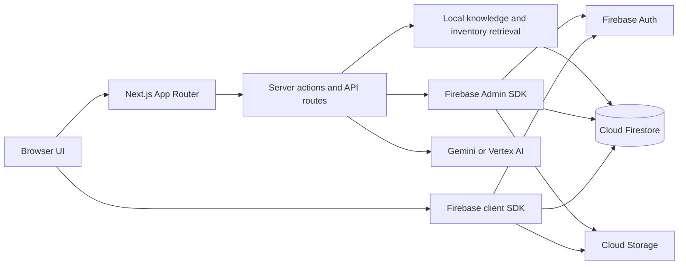

# Implementation architecture

This document describes the checked-in source as inspected on 17 October 2026. References are repository-relative. Runtime Firebase data, provider configuration, and deployed behavior were not inspected.

## Technology stack

| Area | Implementation evidence |
| --- | --- |
| Application | Next.js 15 App Router and React 19 (`package.json`, `src/app/`) |
| Language | TypeScript, with `tsc --noEmit` (`tsconfig.json`, `package.json`) |
| UI | Mantine 8, Tailwind CSS 3, Radix components, Lucide icons, Framer Motion; Recharts for charts (`package.json`, `src/components/`) |
| Forms | React Hook Form, Zod, and `@hookform/resolvers` (`src/app/signin/page.tsx`, `src/app/signup/page.tsx`) |
| Persistence | Firebase client SDK 11 for Auth, Firestore, Storage; Firebase Admin SDK 13 for server operations (`src/firebase/`) |
| AI | Genkit flows, Google Gemini/Vertex model routing, and Vercel AI SDK for chat and advisor responses (`src/ai/`, `src/lib/ai-model-resolver.ts`, `src/app/api/`) |
| Documents and exports | `pdf-lib` for build PDFs and `xlsx`/custom workbook styling for spreadsheet export (`src/lib/build-pdf.ts`, `src/lib/export-excel.ts`) |
| Tests and tooling | Playwright, TypeScript checks, Husky, scripts under `execution/` (`package.json`, `.husky/`) |

The repository declares `npm run lint` as `next lint`. Its actual compatibility with the installed Next.js version must be checked by running it. Firebase Hosting configuration exists in `firebase.json`; the repository alone does not establish the live hosting platform.

## Project structure

| Path | Responsibility |
| --- | --- |
| `src/app/` | App Router pages, root layout, three HTTP route handlers, and server actions. Route-specific components and hooks live beside their pages. |
| `src/components/` | Shared UI, builder, chat, landing, admin, product, and authentication components. `src/components/ui/` holds reusable primitives. |
| `src/hooks/` | Shared client hooks for build actions, downloads, admin sessions, prompts, and UI state. |
| `src/context/` | Client providers for profile, site settings, theme, loading state, sign-out, and advisor jobs. |
| `src/firebase/` | Client initialization/providers, Auth helpers, Firestore hooks, catalog mutations, audit helpers, and Admin SDK initialization. |
| `src/ai/` | Genkit setup, flows for critique, advisor, budget, prebuilt analysis, and part detail extraction; advisor schemas. |
| `src/lib/` | Types, compatibility and performance calculations, inventory retrieval, AI model resolution, knowledge retrieval, PDF and Excel utilities. `src/lib/server/` contains server catalog caching. |
| `src/knowledge/` | Checked-in Markdown hardware guidance read by the knowledge retriever. |
| `src/assets/`, `public/` | Bundled and public images/icons. |
| `directives/` | Operational Markdown procedures for development tasks; not request handlers. |
| `execution/` | Migration, ingestion, audit, benchmark, changelog, and structure scripts. |
| `tests/` | Playwright end-to-end tests, where present. `src/lib/*.test.ts` holds colocated unit tests. |
| `docs/` | Project documentation and previous plans/audits. |
| `firestore.rules`, `firestore.indexes.json`, `storage.rules`, `firebase.json` | Checked-in Firebase policy and index/hosting configuration. |

`docs/project_structure.md` is a generated full tree; its listing can become stale. The table above reflects inspected source folders.

## Request and data flow

`src/app/layout.tsx` mounts theme, Firebase, profile, loading, site-settings, Mantine, and advisor-job providers around `AppLayout`. Most pages are client components. The builder route is a dynamic server page that prefetches a cached catalog through `src/lib/server/builder-catalog.ts` and passes it to a client builder. Other pages read Firestore through hooks or client SDK calls. Reservation server actions run Firestore transactions to check and decrement stock, create an order, and create notifications/audit entries (`src/app/checkout-actions.ts`, `src/app/prebuilt-reservation-actions.ts`).

The builder and chat use deterministic compatibility and bottleneck utilities (`src/lib/compatibility.ts`, `src/lib/bottleneck.ts`, `src/lib/fps-estimator.ts`). The advisor also uses local knowledge, inventory, optional web research, structured output validation, and a Firestore result cache (`src/app/api/ai/build-advisor/recommendations/route.ts`). The chat route streams AI SDK responses with inventory, specification, and current-build tools (`src/app/api/chat/route.ts`).

Prices are displayed in Philippine pesos. `src/lib/utils.ts` formats PHP amounts and defines `USD_TO_PHP_RATE = 60` for its USD conversion helper. Catalog `price` values are stored as numeric values, so the repository does not prove that every live record was derived from USD at that rate.

## Verification limits

- Source inspection confirms code paths and declared dependencies, not that Firebase projects, credentials, indexes, rules, model access, or live data are provisioned.
- UI copy in the About, FAQ, and Contact pages includes commercial and support claims. No shipping-provider, warranty-service, ticket-submission, or contact-email integration was verified from those pages. The Contact form uses a timeout to show a success state and has no network submission (`src/app/contact/page.tsx`).
- No `middleware.ts` route authorization layer was found. Page navigation guards are client components; Firestore rules and server-side checks are separate boundaries. See [authentication and authorization](firebase-and-data.md#authentication-and-authorization).
- `storage.rules` exists, but `firebase.json` does not declare a Storage rules entry. Whether those rules are deployed is not verifiable from the repository.
