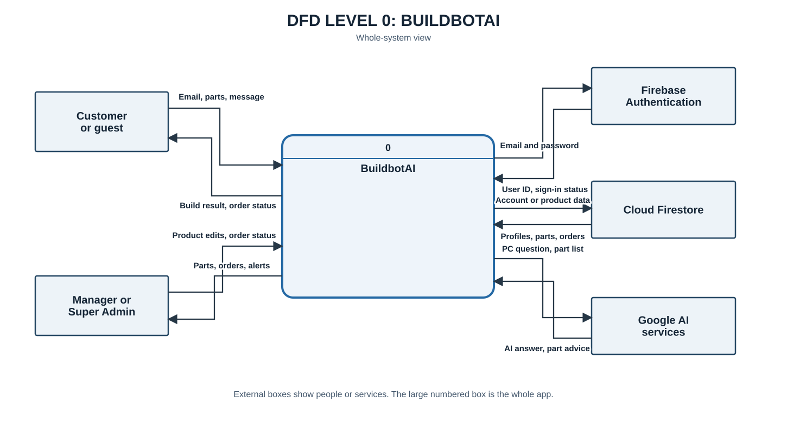
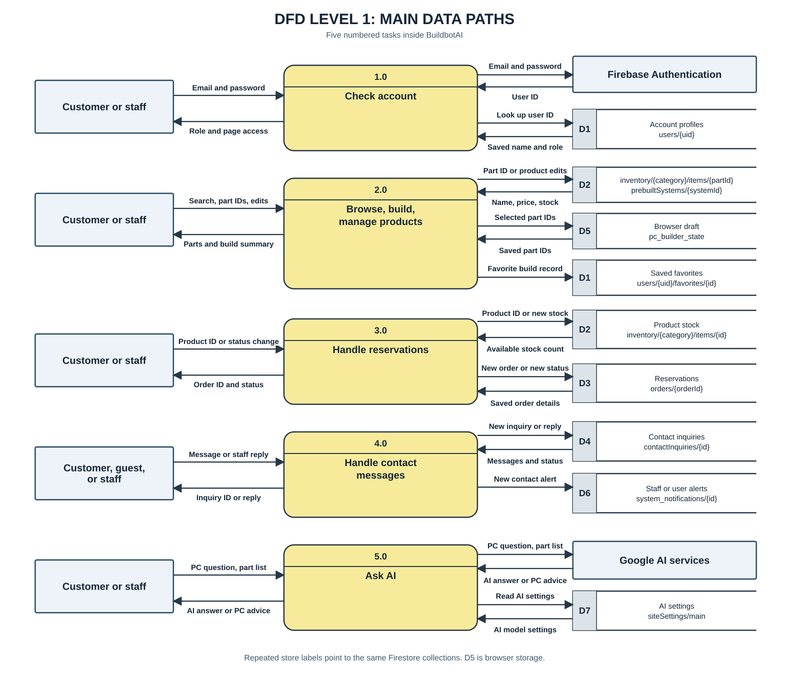
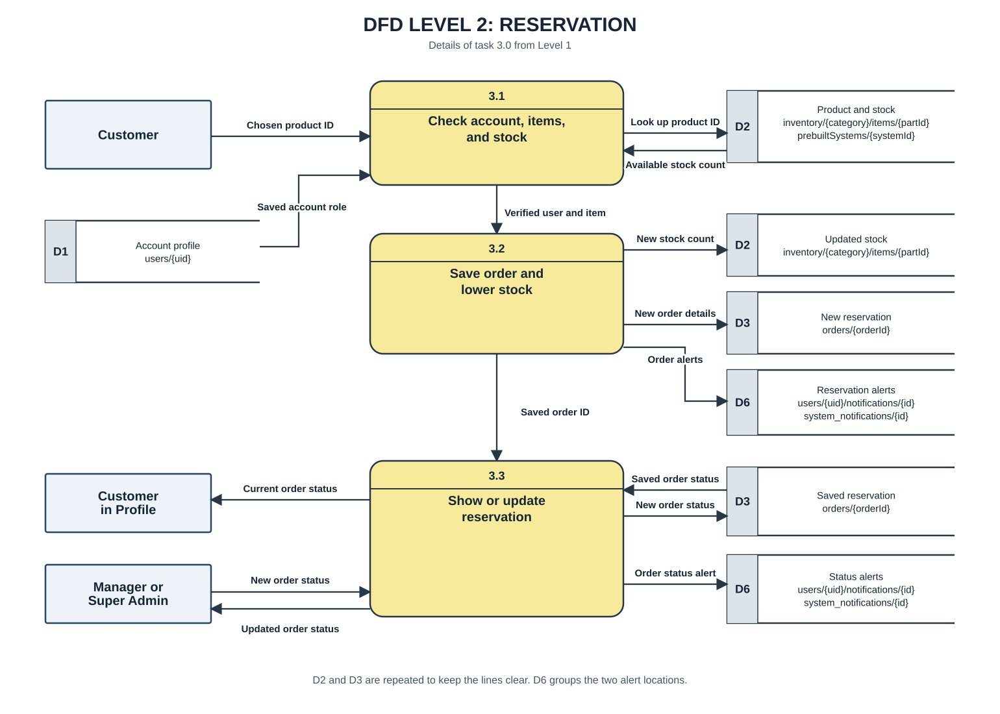
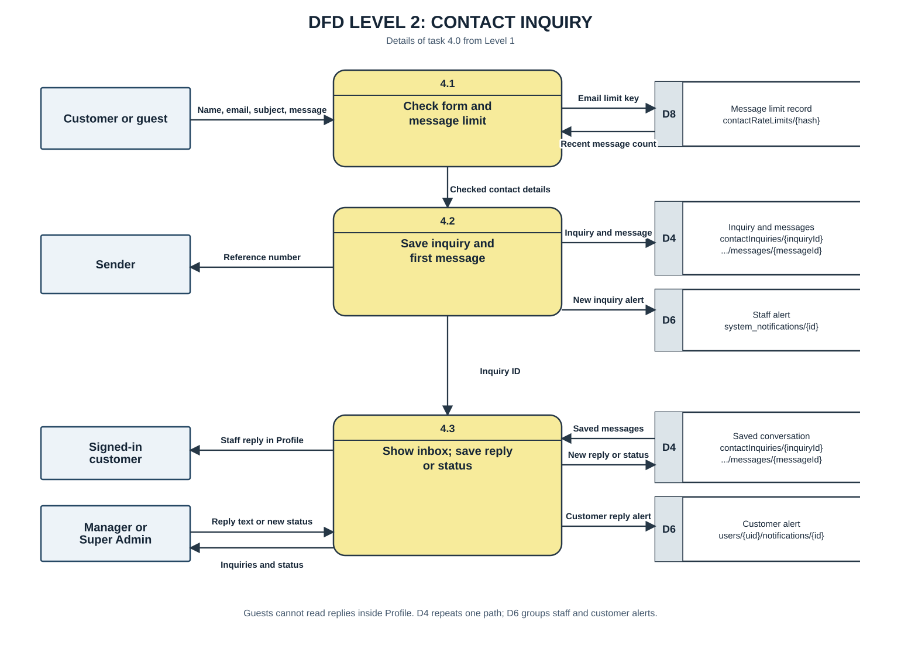

# BuildbotAI data flow diagram

## Introduction

A data flow diagram shows how information moves through an app. It helps readers see who sends information, what the app does with it, and where the information is saved. In BuildbotAI, this includes account details, PC parts and builds, reservations, contact messages, and AI questions. The diagrams also show when the app talks to Firebase or Google AI.

Start with Level 0 for a simple view of the whole app. Level 1 breaks that view into the app's five main tasks. Level 2 follows a real reservation and a contact inquiry step by step. These diagrams describe the main paths found in the code, so they are a guide to how information moves rather than a list of every page or saved record.

This document follows the Level 0, Level 1, and Level 2 approach in the [DFD guide](https://www.geeksforgeeks.org/software-engineering/what-is-dfddata-flow-diagram/). It describes the code checked on 29 October 2026; it does not prove that an outside service is working now.

## How to read the diagrams

- A **plain box** is a person or outside service.
- A **numbered rounded box** is work done by BuildbotAI. Its top strip shows the step number.
- An **open-ended box** marked **D** is a place where data is kept. Its label gives the Firestore path when the data is in Firebase.
- An **arrow** shows which way information moves. The words beside it say what moves.

These are data flow diagrams. They show information moving, so they leave out button clicks and page order.

## Level 0: The whole app

This view shows the whole app as one place where information enters and leaves. A customer or guest can send a question, browse parts, choose a PC build, or send a contact message. A signed-in customer can also ask to reserve available items and view the result. The app sends pages, build results, reservation status, and available replies back to the person using it. A Manager or Super Admin sends product changes, reservation status changes, and settings changes through staff pages. The app shows staff product lists, reservations, reports, and alerts that help them manage those tasks.

The three services on the right have different jobs. Firebase Authentication checks sign-in details and returns the person's identity; the app then uses saved account information to decide what that person may access. Cloud Firestore stores records that need to be shared across devices, such as accounts, products, reservations, and contact messages. Google AI receives requests from AI features and sends back an answer or suggestion for the app to show. An AI answer is not automatically a saved build or reservation. This diagram leaves out the smaller steps inside the app; the next diagrams show those steps.

### What each Level 0 line means

Each row explains one arrow in the diagram. The direction tells you who sends the information and who receives it.

| Line label | Direction | Explanation |
| --- | --- | --- |
| Email, parts, message | Customer or guest → BuildbotAI | A person may enter sign-in details, choose PC parts, or send a contact message. The exact information depends on the task they use. |
| Build result, order status | BuildbotAI → customer or guest | The app shows the result of a build or other page action. A signed-in customer can also see the status of their own reservation. |
| Product edits, order status | Manager or Super Admin → BuildbotAI | Staff send allowed product changes or choose a new status for a reservation. |
| Parts, orders, alerts | BuildbotAI → Manager or Super Admin | Staff pages show saved product details, reservation records, and alerts. |
| Email and password | BuildbotAI → Firebase Authentication | The app sends sign-in details for Firebase to check. |
| User ID, sign-in status | Firebase Authentication → BuildbotAI | Firebase returns the sign-in result and identifies the signed-in account. |
| Account or product data | BuildbotAI → Cloud Firestore | The app asks for a saved record or sends a change to a record, such as a profile, product, or order. |
| Profiles, parts, orders | Cloud Firestore → BuildbotAI | Firestore returns the saved records the app needs to show a page or complete a task. |
| PC question, part list | BuildbotAI → Google AI services | An AI feature sends a PC question and, when needed, selected part details for an answer. |
| AI answer, part advice | Google AI services → BuildbotAI | The AI service returns text or part advice for the app to show. |

## Level 1: The main data paths

This view opens up the single BuildbotAI box from Level 0 into five main tasks. The same person may use several tasks during one visit. The open-ended boxes on the right hold different kinds of data, so an item shown in one place is not always saved in another. Firestore holds shared records such as accounts, products, reservations, and inquiries. **D5** is different: it is an unfinished build kept in that browser, not in Firebase. An unfinished build is not a saved reservation.

1. **Check account.** A person gives sign-in details to the app. Firebase Authentication checks those details and returns a sign-in result. The app also reads the saved profile and role to decide which pages and actions the person may use. The person then receives access suited to that account. A failed sign-in does not give the person staff access.
2. **Browse, build, and manage products.** A person searches the catalogz or chooses parts for a PC. The app reads saved parts and complete PCs so it can show product details and build choices. An unfinished build can stay in the browser. If a signed-in person saves a favorite, that favorite goes under their account in Firestore. Staff product changes also affect the saved catalog shown to other people.
3. **Handle reservations.** A customer sends a reservation request for items offered by the app. The app reads current stock before saving a real reservation. A successful request creates an order record and changes stock; an unavailable item cannot follow that successful path. Staff can later send an allowed status change, and the new status is saved with the order. The customer and staff read the saved order information to see its current state.
4. **Handle contact messages.** A customer or guest sends a contact inquiry. Staff can read it and can reply inside the app when the inquiry belongs to a signed-in customer. The app keeps the inquiry and its messages in Firestore so staff can return to the conversation. The sender receives a reference number or an error when the inquiry is submitted. A signed-in customer can see available replies in Profile; a guest does not have that in-app view.
5. **Ask AI.** A person sends a question or PC details to an AI feature in the app. The app passes the request to Google AI and returns the answer or suggestion to the person. The answer may help the person choose parts, but it does not place a reservation by itself. Chat history may be kept in that browser; the diagram does not show it as a Firestore record.

The next two diagrams give a closer look at the saved reservation and contact message paths. They show where a record is created, who can update it, and what a person can see afterward.

### What each Level 1 line means

The numbers in the direction column refer to the five yellow task boxes. **D1–D7** refer to the data boxes shown beside them. Some data boxes repeat so the arrows stay easy to follow.

| Line label | Direction | Explanation |
| --- | --- | --- |
| Email and password | Customer or staff → 1.0 Check account | A person enters their sign-in details. |
| Role and page access | 1.0 → customer or staff | The app uses the sign-in result and saved role to show the pages the account may use. |
| Email and password | 1.0 → Firebase Authentication | The app asks Firebase to check the entered details. |
| User ID | Firebase Authentication → 1.0 | Firebase identifies the signed-in account after a successful sign-in. |
| Look up user ID | 1.0 → D1 account profiles | The app uses the account ID to find `users/{uid}`. |
| Saved name and role | D1 account profiles → 1.0 | The saved profile supplies account details and the role used for access checks. |
| Search, part IDs, edits | Customer or staff → 2.0 Browse, build, manage products | A customer searches or chooses parts; staff may send product changes through staff pages. |
| Parts and build summary | 2.0 → customer or staff | The app shows matching products, selected parts, or the current build summary. |
| Part ID or product edits | 2.0 → D2 parts and PCs | The app uses an item ID to find a product, or saves an allowed staff change. |
| Name, price, stock | D2 parts and PCs → 2.0 | The catalog returns saved details needed to show parts and complete PCs. |
| Selected part IDs | 2.0 → D5 browser draft | The app keeps the unfinished build in the current browser. |
| Saved part IDs | D5 browser draft → 2.0 | The app loads the unfinished choices when the builder needs them again. |
| Favorite build record | 2.0 → D1 saved favorites | A signed-in customer saves a favorite build under their account. |
| Product ID or status change | Customer or staff → 3.0 Handle reservations | A customer chooses a product to reserve; staff may choose a new status for an existing order. |
| Order ID and status | 3.0 → customer or staff | The app shows the reservation result or the order's current status. |
| Product ID or new stock | 3.0 → D2 product stock | The app names the product to check, or saves its reduced stock after a valid reservation. |
| Available stock count | D2 product stock → 3.0 | The saved stock amount lets the app decide whether a reservation can be made. |
| New order or new status | 3.0 → D3 reservations | The app saves a new order or an allowed change to an existing order's status. |
| Saved order details | D3 reservations → 3.0 | The app reads the order record so it can show the current reservation details. |
| Message or staff reply | Customer, guest, or staff → 4.0 Handle contact messages | A person sends an inquiry, or staff send an in-app reply to a signed-in customer's inquiry. |
| Inquiry ID or reply | 4.0 → customer, guest, or staff | The sender gets an inquiry reference; people with access can later see saved replies or status. |
| New inquiry or reply | 4.0 → D4 contact inquiries | The app saves a new inquiry, its first message, or a later staff reply. |
| Messages and status | D4 contact inquiries → 4.0 | The app reads the saved conversation and its current status. |
| New contact alert | 4.0 → D6 alerts | The app saves an alert about an inquiry or reply for the people who should see it. |
| PC question, part list | Customer or staff → 5.0 Ask AI | A person asks a PC question and may include selected parts. |
| AI answer or PC advice | 5.0 → customer or staff | The app shows the answer returned by the AI feature. |
| PC question, part list | 5.0 → Google AI services | The app sends the question and needed part details to the AI service. |
| AI answer or PC advice | Google AI services → 5.0 | The AI service returns the text the app will show. |
| Read AI settings | 5.0 → D7 AI settings | The app asks for saved settings used by supported AI features. |
| AI model settings | D7 AI settings → 5.0 | The saved settings tell the app which AI options to use. |

### Where the data is read in Firestore

The paths below are **patterns**, not the name of one real person's record. Words in braces, such as `{uid}`, stand for an ID chosen by the app. Repeated **D1**, **D2**, **D3**, and **D4** boxes point to the same saved paths each time they appear. **D6** groups two alert locations.

| Data used | Firestore path read by the app | Where it is used |
| --- | --- | --- |
| Account profile and role | `users/{uid}` | Sign-in checks, Profile, and reservation checks. |
| Staff key record, when used | `authKeys/{keyId}` | Staff access check. No real key value is shown here. |
| Saved build favorites | `users/{uid}/favorites/{favoriteId}` | Loading saved builds in Profile or the Builder. |
| Individual PC parts and stock | `inventory/{category}/items/{partId}` | Catalog, Builder, stock checks, and staff stock work. |
| Ready-made PC records | `prebuiltSystems/{systemId}` | Prebuilt pages and prebuilt reservation checks. |
| Reservations | `orders/{orderId}` | Customer order status and staff reservation work. |
| Contact inquiry and messages | `contactInquiries/{inquiryId}` and `contactInquiries/{inquiryId}/messages/{messageId}` | Contact Inbox and reply history. |
| Contact message limit | `contactRateLimits/{hash}` | Checking how many Contact messages were sent from an email during the time window. |
| AI settings and some saved AI results | `siteSettings/main` and, for Build Advisor recommendations, `ai_recommendation_cache_v3/{cacheKey}` | Model choice and reuse of a recent valid recommendation. |
| Hardware facts used by some AI tools | `buildbot_hardware_vector/{category}/items/{itemId}` | Finding saved part facts for supported AI requests. |

The app also **writes** alerts to `users/{uid}/notifications/{notificationId}` and `system_notifications/{notificationId}`. A draft build and chat history are held in browser storage, so they do not have a Firestore document path. These locations come from `src/lib/inventory-paths.ts`, `src/context/user-profile.tsx`, `src/app/profile/hooks/use-favorites.ts`, `src/app/profile/hooks/use-reservations.ts`, `src/app/api/contact/`, `src/app/api/ai/build-advisor/recommendations/route.ts`, and `src/lib/vector-retriever.ts`.

## Level 2: A real reservation

This diagram follows a real reservation from the customer's choice to the saved order. The customer first chooses a part or a complete PC build and sends that choice to the app. The app checks who is making the request, reads the current product details, and checks whether the needed stock is available. It uses the latest saved stock at the time of the request, because the amount shown earlier on a page may have changed. If a required check fails, the app does not complete the successful save path shown here.

For a valid request, one protected Firestore action saves the order and reduces the stock together. This keeps the new order tied to the stock it uses. The app also saves alerts for the customer and staff so they can see that a reservation was made. The order record holds the reservation and its current status; it is the record the customer later sees in Profile and staff see in their order list. A Manager or Super Admin may send an allowed status change, which updates the saved order and can create more alerts. The status shown later comes from the saved order rather than from the customer's original form.

The diagram focuses on the main order, stock, and alert records; it does not show every extra record or every rule used to approve a status change.

### What each reservation line means

This close view breaks task **3.0 Handle reservations** into three steps. The **D** boxes name the saved Firestore records used by those steps.

| Line label | Direction | Explanation |
| --- | --- | --- |
| Chosen product ID | Customer → 3.1 Check account, items, and stock | The customer sends the ID of the product they want to reserve. |
| Look up product ID | 3.1 → D2 product and stock | The app looks up the chosen product in the saved catalog. For a listed complete PC, it may also read `prebuiltSystems/{systemId}`. |
| Available stock count | D2 product and stock → 3.1 | The saved product record supplies the current stock amount. |
| Saved account role | D1 account profile → 3.1 | The app reads the saved user profile to check the account used for the request. |
| Verified user and item | 3.1 → 3.2 Save order and lower stock | The account, product, and stock checks provide the details needed to continue. |
| New stock count | 3.2 → D2 updated stock | A successful reservation lowers the saved stock amount. |
| New order details | 3.2 → D3 new reservation | The app saves a new order with the chosen product and reservation details. |
| Order alerts | 3.2 → D6 reservation alerts | The app saves alerts for the customer and staff about the new reservation. |
| Saved order ID | 3.2 → 3.3 Show or update reservation | The new order ID lets the app find this reservation later. |
| Saved order status | D3 saved reservation → 3.3 | The app reads the order's current saved status. |
| New order status | 3.3 → D3 saved reservation | An allowed staff status change is saved in the order record. |
| Current order status | 3.3 → customer in Profile | The customer sees the status from their saved reservation. |
| New order status | Manager or Super Admin → 3.3 | Staff choose an allowed new status for an order. |
| Updated order status | 3.3 → Manager or Super Admin | Staff see the result after the order status is changed. |
| Order status alert | 3.3 → D6 status alerts | The app saves an alert when the status change calls for one. |

## Level 2: A contact inquiry

This diagram starts when a customer or guest fills out the Contact form. The form sends the person's name, email, subject, and message to the app's contact API. The app checks the submitted information before saving it. If the request cannot be accepted, it returns an error instead of a successful reference number. If it is accepted, Firestore gets an inquiry record and the first message in that inquiry. The person receives a reference number that identifies the new inquiry.

Staff read saved inquiries in the Contact Inbox. A Manager or Super Admin can update an inquiry's status. They can add an in-app reply when the inquiry belongs to a signed-in customer. The reply and status are saved with the inquiry so staff can see the latest conversation later. A signed-in customer can see their inquiry and available replies in Profile. A guest can submit the form and receive a reference number, but cannot follow the reply inside Profile without a signed-in account. The diagram shows information moving between the form, saved messages, staff, and customer; it does not promise that a guest receives a separate email reply.

### What each contact line means

This close view breaks task **4.0 Handle contact messages** into three steps. The message limit record helps stop too many submissions from the same email within the time window.

| Line label | Direction | Explanation |
| --- | --- | --- |
| Name, email, subject, message | Customer or guest → 4.1 Check form and message limit | The Contact form sends the information entered by the sender. |
| Email limit key | 4.1 → D8 message limit record | The app uses a key made from the email and current hour to find that email's limit record. |
| Recent message count | D8 message limit record → 4.1 | The saved count tells the app whether another message can be accepted. |
| Checked contact details | 4.1 → 4.2 Save inquiry and first message | Valid details continue to the save step. An invalid request returns an error instead. |
| Inquiry and message | 4.2 → D4 inquiry and messages | The app saves the inquiry record and the sender's first message. |
| New inquiry alert | 4.2 → D6 staff alert | The app saves an alert so staff can see the new inquiry. |
| Reference number | 4.2 → sender | The sender receives the new inquiry's ID after it is saved. |
| Inquiry ID | 4.2 → 4.3 Show inbox; save reply or status | The saved ID identifies the conversation that staff can open later. |
| Saved messages | D4 saved conversation → 4.3 | The app reads the inquiry and its messages for the inbox. |
| New reply or status | 4.3 → D4 saved conversation | The app saves a staff reply or an allowed status change. |
| Staff reply in Profile | 4.3 → signed-in customer | A signed-in customer can see an in-app reply to their inquiry in Profile. |
| Reply text or new status | Manager or Super Admin → 4.3 | Staff enter a reply or choose a new inquiry status. |
| Inquiries and status | 4.3 → Manager or Super Admin | The staff inbox shows saved inquiries and their current status. |
| Customer reply alert | 4.3 → D6 customer alert | The app saves an alert for the signed-in customer when staff reply. |

## Important notes

- **Saved builds:** The current draft build is kept in browser storage. A favorite build is saved under the signed-in user's Firestore record (`src/app/builder/hooks/use-builder-logic.ts`, `src/app/profile/hooks/use-favorites.ts`).
- **Real reservations:** Part and build reservations create Firestore orders and stock changes (`src/app/public-product-actions.ts`, `src/app/checkout-actions.ts`, `src/app/prebuilt-reservation-actions.ts`).
- **AI chat:** Chat history is kept in browser storage. AI requests go through app routes or server actions, and the result is returned to the page (`src/components/chat/hooks/use-floating-chat.ts`, `src/app/api/chat/route.ts`, `src/app/api/ai/build-advisor/recommendations/route.ts`, `src/app/actions.ts`).
- **Contact messages:** The Contact form uses `/api/contact`, which saves inquiry and message records. Staff replies use `/api/contact/messages` (`src/app/contact/page.tsx`, `src/app/api/contact/route.ts`, `src/app/api/contact/messages/route.ts`).

This is a readable map of the main data paths, not a list of every Firestore collection or API route. Some paths change with the signed-in role, stock, and store settings.
