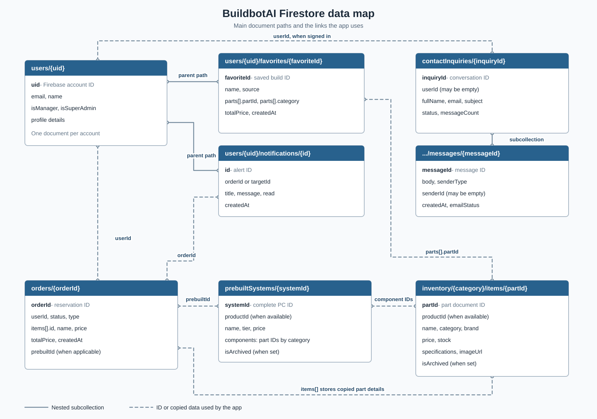

# BuildbotAI Firestore data map

## What this shows

This diagram shows the main kinds of records that BuildbotAI keeps in Cloud Firestore. Each blue box gives a document path and a few useful fields. The lines show how the app connects records. This is a **data map**, not a data flow diagram: it shows saved records and their links, rather than the steps a person takes through the app.

## How to read it

- A path such as `users/{uid}` is a pattern. The words inside braces stand for an ID; they are not a real person's data.
- A **solid line** means a subcollection sits under a parent document in its Firestore path. For example, `users/{uid}/favorites/{favoriteId}` sits under the user's path.
- A **dashed line** means a document holds an ID or a copy of data that the app uses to connect it to another document. Firestore does not make these links for the app.
- Fields marked **when applicable**, **when available**, or **may be empty** are not guaranteed in every document.
- The diagram shows important fields, not every field that the app may save.

The boxes do not represent SQL tables. A Firestore collection contains documents, and a document can have a subcollection beneath its path. A line between two boxes shows how the checked-in app uses the records; it does not mean Firestore automatically checks that both records exist. In this map, **ID** means a value used to identify a saved record, while **copy** means details stored again in another record.

## What each box holds

### Account: `users/{uid}`

This document belongs to one Firebase account. The `{uid}` in its path is the account ID supplied by Firebase Authentication. The profile holds information such as an email address and name. It also has `isManager` and optional `isSuperAdmin` flags that the app uses when deciding which role the person has. Customer reservations use the account ID to identify the customer. Favorite builds and personal notifications sit under this account path, but they are separate documents; they are not fields inside the main profile document. See `src/lib/types.ts`, `src/context/user-profile.tsx`, and `src/app/public-product-actions.ts`.

### Favorite build: `users/{uid}/favorites/{favoriteId}`

A favorite is a build the signed-in customer chose to keep. Its path includes the owner's account ID, so the app loads favorites from that user's subcollection. The document stores a name, the selected parts, a saved total price, where the build came from, and when it was saved. Each saved part can include its category, part ID, name, and price. Saving a favorite does **not** create an order or reduce stock. If a part's catalog record changes later, the saved part details may no longer match the current catalog; the app can use the saved part ID and category when it needs to check the current item. See `src/app/profile/hooks/use-favorites.ts` and `src/lib/types.ts`.

### Personal alert: `users/{uid}/notifications/{id}`

This subcollection holds alerts for one customer. A reservation alert can include an `orderId` so the app knows which order the alert concerns. A support reply alert can use `targetId` to point to a contact inquiry instead. The alert also stores text, a read flag, and a creation time. These alert documents are separate from the order or inquiry they mention. The diagram draws the order link and leaves out the inquiry link to avoid crossing more lines. See `src/lib/types.ts`, `src/app/public-product-actions.ts`, and `src/app/api/contact/messages/route.ts`.

### Reservation: `orders/{orderId}`

Each order document records one reservation. It stores the customer's `userId`, a status, a total price, and an `items` list. Each item in that list includes an ID, name, category, and price copied when the order is made. This copy helps the order keep the details used at reservation time even if the catalog later changes. A ready-made PC reservation can also have `prebuiltId`, `prebuiltName`, and `prebuiltTier`; those fields are not required for every order. The order is outside the user's path, so the customer Profile page finds its orders by looking for documents whose `userId` matches the signed-in account. See `src/lib/types.ts`, `src/app/public-product-actions.ts`, and `src/app/profile/hooks/use-reservations.ts`.

### Ready-made PC: `prebuiltSystems/{systemId}`

A prebuilt document describes a complete PC offered by the app. It has a name, tier, price, and a `components` object that names part IDs by category. Some categories can hold more than one ID, such as RAM or storage. The app uses those IDs to look up the current part records when it needs the actual components. A prebuilt may also have a `productId` used by the current product route. It is a catalog record, not an order: a customer gets an order only after a valid reservation is saved. See `src/lib/types.ts`, `src/lib/server/public-products.ts`, and `src/app/prebuilt-reservation-actions.ts`.

### Catalog part: `inventory/{category}/items/{partId}`

This path holds one part inside an inventory category, such as CPU or GPU. A part document stores its name, category, brand, price, stock, image address, and technical details. Some fields, including `productId` and `isArchived`, may be present only when they apply. The category and part ID together give the app the full path to the item. Prebuilts and favorites keep part IDs so the app can connect those saved choices to current catalog items. During a valid reservation, the app reads the latest stock and lowers it while saving the order. See `src/lib/inventory-paths.ts`, `src/lib/types.ts`, and `src/app/public-product-actions.ts`.

### Contact inquiry: `contactInquiries/{inquiryId}`

An inquiry is the main record for one Contact conversation. It stores the sender's name and email, the subject, the current status, message count, and times that help the inbox show recent activity. The `userId` holds the account ID when the sender is signed in. A guest inquiry has no account ID there. The inquiry is the parent of its messages, so the conversation can have several messages without putting all message text into the main inquiry document. Staff can see inquiries in their inbox; a signed-in customer can see inquiries linked to their account. See `src/lib/contact-types.ts`, `src/app/api/contact/route.ts`, and `src/app/profile/hooks/use-customer-support.ts`.

### Contact message: `contactInquiries/{inquiryId}/messages/{messageId}`

This is one message inside a contact inquiry. The first message is saved when the Contact form is accepted. Later messages can be replies in the same inquiry. A message stores its text, sender type, sender name, creation time, and, when available, the sender's account ID. The sender type tells the app whether the message came from a customer or staff. A guest's first message can have no sender account ID. The message can also hold an email delivery status when that feature is used, but the Firestore message exists whether or not email delivery succeeds. See `src/lib/contact-types.ts`, `src/app/api/contact/route.ts`, and `src/app/api/contact/messages/route.ts`.

## What the connections mean

| Connected records | Field or path | What it means |
| --- | --- | --- |
| User → favorite builds | `users/{uid}/favorites/{favoriteId}` | A saved build belongs to the user whose ID appears in the path. A favorite stores selected part IDs and some copied part details. |
| User → personal notifications | `users/{uid}/notifications/{id}` | A customer's alerts are kept under that customer's path. An alert may hold an `orderId` or another `targetId`. |
| User → reservations | `orders/{orderId}.userId` | An order stores the ID of the customer who made the reservation. The app uses that ID when showing a customer's orders. |
| User → contact inquiries | `contactInquiries/{inquiryId}.userId` | A signed-in customer's inquiry can hold their account ID. A guest inquiry has no user ID, so the line is optional. |
| Contact inquiry → messages | `contactInquiries/{inquiryId}/messages/{messageId}` | Each message sits under its inquiry's path. One inquiry can have the first message and later replies. |
| Favorite build → parts | `parts[].partId` and `parts[].category` | A saved build lists the parts chosen when it was saved. These IDs can be used to look up current catalog parts. Saved names and prices may differ from today's catalog. |
| Personal notification → reservation | `orderId` | A reservation alert can name the order it is about. Contact alerts may use `targetId` for an inquiry instead; that second link is left out of the picture to keep it readable. |
| Reservation → complete PC | `prebuiltId` | A reservation for a ready-made PC may store the ID of its prebuilt record. Other reservations do not need this field. |
| Complete PC → parts | `components` | A prebuilt record stores part IDs by category. The app uses them to find the listed parts. |
| Reservation → parts | `items[].id`, `items[].name`, and `items[].price` | An order saves a copy of the item details used when the reservation was made. It does not rely only on the part's current name or price. |

## How the records work together

### Saving a favorite build

The customer selects parts in the builder and chooses to save the build. The app writes a new document under `users/{uid}/favorites`. That document keeps the build name, selected part details, total price, and source. When the customer opens saved builds, the app reads that subcollection and adds each document's ID to the displayed result. This path does not create an `orders` document. The code for these steps is in `src/app/profile/hooks/use-favorites.ts`.

### Reserving a product

The customer sends a product ID with their signed-in account. The reservation action checks the account profile, finds the product, and reads the latest stock for the needed part or parts. For a complete PC, it uses the prebuilt's component IDs to find its parts. If the checks pass, one Firestore transaction lowers stock, creates an `orders/{orderId}` document, and saves customer and staff alerts. The order keeps copied item details and the customer's ID. Later, the Profile page finds that customer's orders by `userId` and shows their saved status. These steps are in `src/app/public-product-actions.ts`, `src/lib/server/public-products.ts`, and `src/app/profile/hooks/use-reservations.ts`.

### Sending a contact inquiry

The Contact form sends the sender's name, email, subject, and message. After validation and a message limit check, the app creates a `contactInquiries/{inquiryId}` document and the first document under its `messages` subcollection. It also creates a staff alert. A signed-in sender's account ID can be stored as `userId`; a guest inquiry leaves that link empty. Staff can later add messages to the same subcollection, and a signed-in customer can see replies to their own inquiry in Profile. The app stores an alert for that customer when staff reply. These steps are in `src/app/api/contact/route.ts`, `src/app/api/contact/messages/route.ts`, and `src/app/profile/hooks/use-customer-support.ts`.

## Main document paths

| Firestore path | What it holds | Code checked |
| --- | --- | --- |
| `users/{uid}` | Account profile and staff role flags. | `src/lib/types.ts`, `src/context/user-profile.tsx` |
| `users/{uid}/favorites/{favoriteId}` | A named saved build and its chosen parts. | `src/lib/types.ts`, `src/app/profile/hooks/use-favorites.ts` |
| `users/{uid}/notifications/{id}` | Alerts shown to one customer. | `src/lib/types.ts`, `src/app/public-product-actions.ts`, `src/app/api/contact/messages/route.ts` |
| `orders/{orderId}` | A reservation, its item copy, customer ID, total, and status. | `src/lib/types.ts`, `src/app/public-product-actions.ts` |
| `prebuiltSystems/{systemId}` | A ready-made PC and the part IDs in it. | `src/lib/types.ts`, `src/app/prebuilt-reservation-actions.ts` |
| `inventory/{category}/items/{partId}` | A catalog part, its price, stock, and specifications. | `src/lib/inventory-paths.ts`, `src/lib/types.ts` |
| `contactInquiries/{inquiryId}` | A contact conversation and its current status. | `src/lib/contact-types.ts`, `src/app/api/contact/route.ts` |
| `contactInquiries/{inquiryId}/messages/{messageId}` | The text and sender details for one message. | `src/lib/contact-types.ts`, `src/app/api/contact/messages/route.ts` |

## Other saved records

The picture focuses on the records people most often need to understand together. The code also uses these supporting records:

| Path | Why the app uses it |
| --- | --- |
| `system_notifications/{id}` | Stores alerts for staff, including new reservations and contact inquiries. |
| `reservationOperations/{userId}_{operationId}` | Connects a reservation request to its order ID so a repeated request does not make another order. |
| `user_auditLogs/{id}` | Records some customer actions, including a completed reservation. |
| `contactRateLimits/{hash}` | Stores a recent count used to limit contact messages from the same email during a time window. |
| `contactMailAliases/{id}` | Supports email reply routing when contact email is enabled. The diagram does not show any token values. |
| `siteSettings/main` | Stores site and AI settings used by parts of the app. |
| `ai_recommendation_cache_v3/{key}` | Lets supported AI recommendation requests reuse a recent saved result. |
| `buildbot_hardware_vector/{category}/items/{id}` | Holds part facts used by supported AI lookup code. |

These paths are evidenced by `src/app/public-product-actions.ts`, `src/app/api/contact/route.ts`, `src/app/api/contact/messages/route.ts`, `src/context/site-settings-context.tsx`, `src/app/api/ai/build-advisor/recommendations/route.ts`, and `src/lib/vector-retriever.ts`. For more about the Firebase services and the movement of data, see the [Firebase integration and data model](firebase-and-data.md) and the [data flow diagrams](data-flow-diagram.md).

## Limits of this map

The paths and fields above come from the checked-in code. Firestore does not require every document to have the same fields, and older records may differ. A dashed link may also fail to find a current catalog item if that item was removed or changed; the app must handle that case. This map does not list every collection, field, index, access rule, or older path kept for migration. It does not prove what data currently exists in a live Firebase project.
