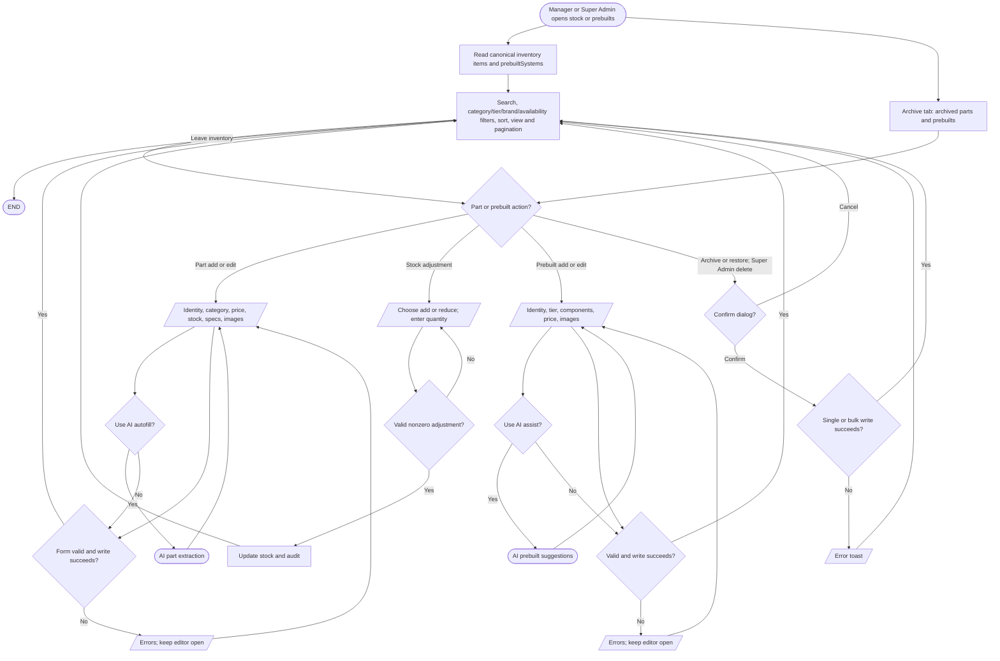

# Admin inventory and archive

## Simple explanation

This flowchart shows how staff manage parts and ready-made PCs. Staff can search, filter, add, edit, and change stock. Items can be moved to the archive instead of being removed at once. A confirmation box helps stop an action from happening by mistake. Managers can restore items, while permanent delete actions are kept for the Super Admin.

Sources: `src/app/admin/page.tsx`, `src/app/admin/components/stock-tab.tsx`, `prebuilt-tab.tsx`, `archive-tab.tsx`, `src/components/inventory-table.tsx`, `inventory-part-card.tsx`, `inventory-prebuilt-card.tsx`, `prebuilts-table.tsx`, `add-part-editor.tsx`, `add-prebuilt-dialog.tsx`, `add-stock-dialog.tsx`, `src/app/admin/hooks/use-inventory.ts`, `use-bulk-actions.ts`. The separate staff prebuilt builder selects catalog components, checks compatibility, and invokes AI description generation before saving (`src/app/admin/prebuilt-builder/page.tsx`).
