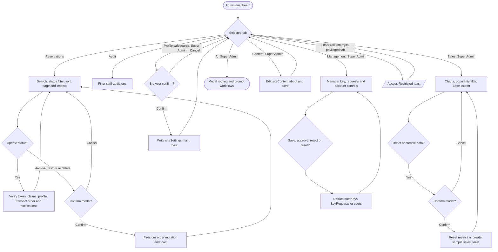

# Admin operations

Sources: `src/app/admin/page.tsx`, `src/app/admin/hooks/use-admin-core.ts`, `use-orders.ts`, `use-sales-actions.ts`, `src/app/admin/components/reservations-tab.tsx`, `sales-tab.tsx`, `admin-tab-header.tsx`, `src/components/super-admin-settings.tsx`, `about-management.tsx`, `src/app/profile/hooks/use-emergency-controls.ts`. Firestore rule enforcement and Admin SDK checks differ by operation; see [errors](error-handling-flowcharts.md) and [interaction inventory](interaction-inventory.md).
