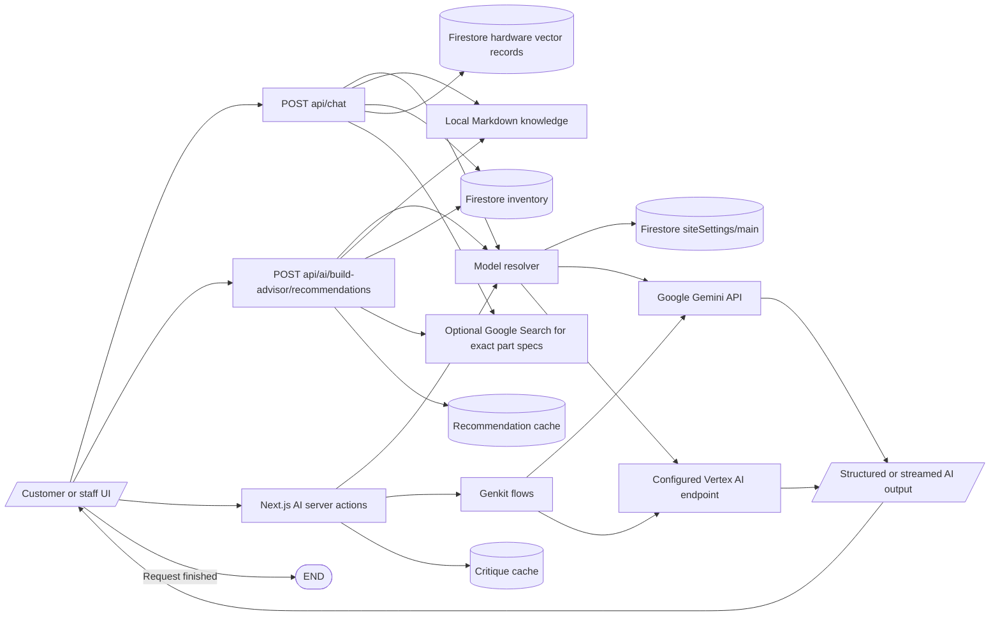

# AI architecture

## Simple explanation

This flowchart shows how an AI request moves through the app. A page or tool sends the user’s request to a server action or API route. The system picks the AI model set for that feature. It may also read product data or saved guide data before asking the model. The result is checked and then shown back on the page.

The model resolver reads configured routing for `chatbot`, `buildAdvisor`, and `prebuiltAdvisor`, caches settings briefly, and falls back to the default Gemini model when a fine-tuned endpoint cannot be initialized or is marked degraded (`src/lib/ai-model-resolver.ts`). Genkit flows call `safeGenkitGenerate` where shown in their source. Chat uses AI SDK `streamText`; the advisor route uses AI SDK `generateText` and returns a completed validated JSON object in a `ReadableStream` (`src/app/api/chat/route.ts`, `src/app/api/ai/build-advisor/recommendations/route.ts`).

The code declares `gemini-2.5-flash` as the default model, permits configured Gemini variants and a Vertex endpoint, and uses `gemini-embedding-001` for hardware vector queries. The repository proves code paths, not that every configured endpoint or model is available at runtime. `src/ai/genkit.ts`, `src/components/ai-model-settings.tsx`, and `src/app/actions.ts` contain the setup and administrative controls. No conversation server storage was found; the client stores chat history in browser local storage (`src/components/chat/hooks/use-floating-chat.ts`).
