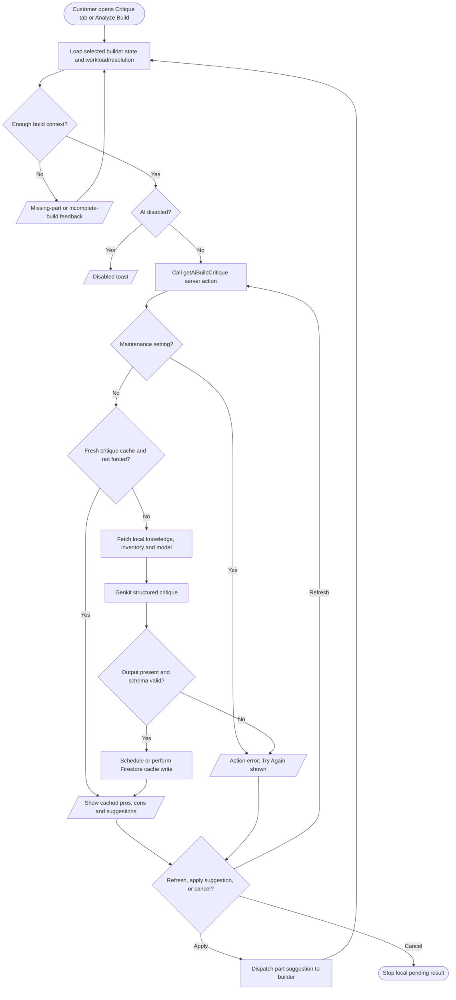

# AI build critique

The advisor page controls critique in `src/app/ai-build-advisor/hooks/use-critique-logic.ts`; `src/components/ai-build-critique.tsx` renders the analysis and retry controls. The server flow is `src/ai/flows/ai-build-critique.ts`, wrapped by `getAiBuildCritique` in `src/app/actions.ts`. Its Firestore cache collection is `ai_critique_cache_v1`. A cancelled client request does not establish remote cancellation.
