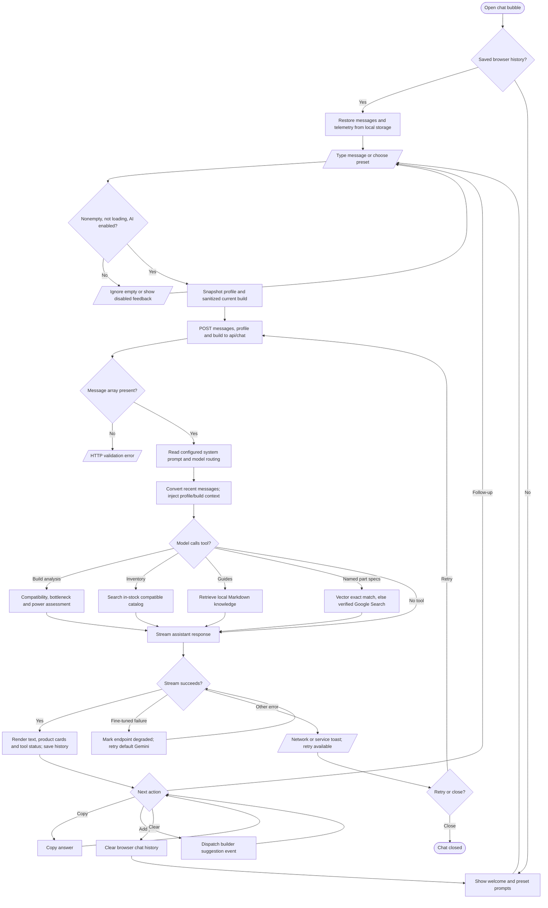

# Floating chatbot workflow

The builder and staff prebuilt builder mount the floating chat (`src/components/builder-floating-chat.tsx`, `src/app/builder/builder-page.tsx`, `src/app/admin/prebuilt-builder/page.tsx`).

The client invokes `useChat` and persists `pc_chat_history_v2` and telemetry in local storage. The server route offers `analyzeCurrentBuild`, `searchInventory`, `queryCompatibilityGuides`, and `queryPartSpecifications`; the model decides whether to call them. There is no separate deterministic intent classifier in the route. Sources: `src/components/chat/hooks/use-floating-chat.ts`, `src/components/chat/`, `src/app/api/chat/route.ts`, `src/lib/chat-part-specifications.ts`, `src/lib/chat-stream-fallback.ts`.
