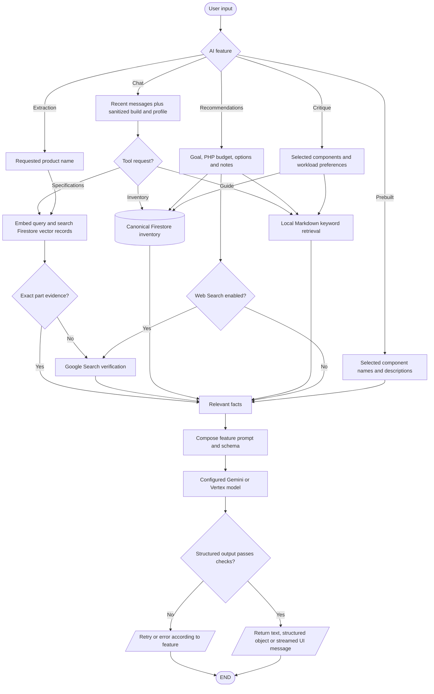

# AI data processing and retrieval

## Simple explanation

This flowchart shows how the AI finds and prepares useful information. It can read the current build, product records, or hardware guide data. The data is cleaned and shaped before it is added to the AI request. The AI uses that information to make a more useful answer. The result is then checked before the app displays or saves it.

`src/lib/knowledge-retriever.ts` indexes checked-in `src/knowledge/*.md` in memory and ranks paragraphs by keywords. `src/lib/vector-retriever.ts` computes a 768-dimensional Gemini embedding and queries Firestore vector records. The chat specification tool first tries that vector source, then a grounded Google Search response, and rejects a mismatched product (`src/lib/chat-part-specifications.ts`). The advisor's optional web research is a separate Google Search call (`src/lib/advisor-web-research.ts`). Recommendation and critique results can be cached in Firestore; chat messages are stored only in the browser by the current client hook.
