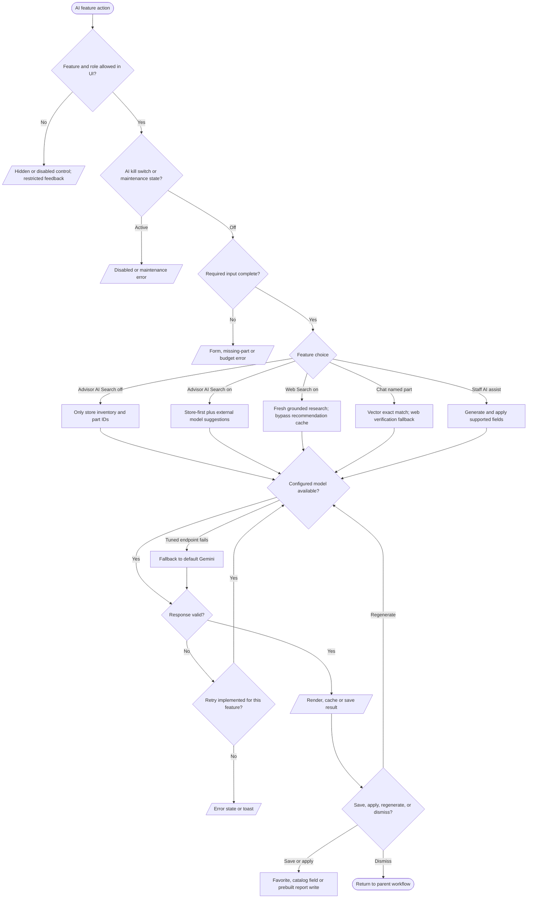

# AI choices and conditional paths

This is a cross-feature decision map, not a claim that every feature has every branch. Recommendation generation has up to three server validation attempts; critique and extraction use Genkit model fallback; chat has tuned stream fallback. The advisor offers separate AI Search and Web Search toggles (`src/components/chat-form.tsx`). Customer AI and staff AI controls read a site kill switch, while some server flows also check maintenance (`src/context/site-settings-context.tsx`, feature hooks, `src/app/api/ai/build-advisor/recommendations/route.ts`, `src/ai/flows/ai-build-critique.ts`). Client cancellation may abandon the local result; it does not prove the server model request was terminated. Feature diagrams show the exact branches.
