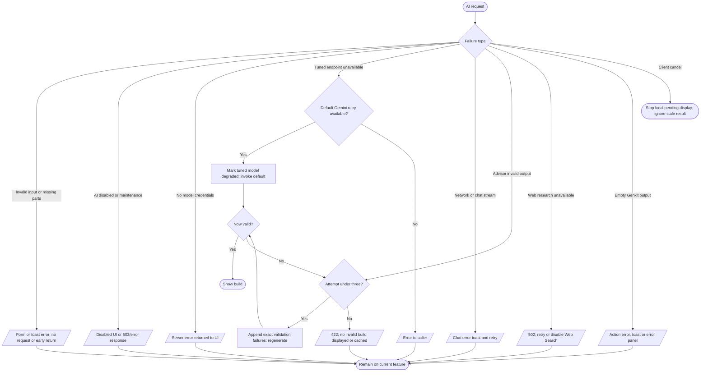

# AI error handling

The server action wrappers use a three-minute timeout and convert several errors into response objects (`src/app/actions.ts`). The advisor validates output after generation and retries up to three times; its `ReadableStream` does not stream model tokens (`src/app/api/ai/build-advisor/recommendations/route.ts`). Chat has a specific tuned stream fallback and a client Retry action (`src/app/api/chat/route.ts`, `src/lib/chat-stream-fallback.ts`, `src/components/chat/hooks/use-floating-chat.ts`). The exact behavior of a remote model request after client cancellation cannot be verified from static code.
