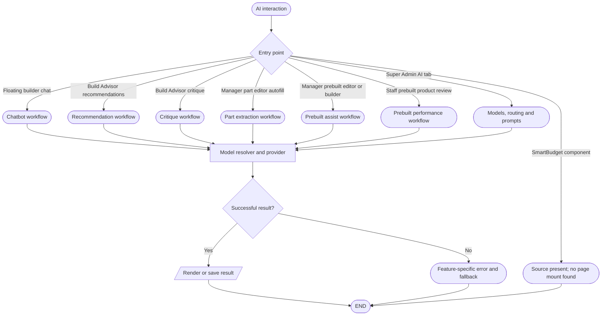

# AI system flowchart index

## Simple explanation

This flowchart is the main map for every AI feature in the project. It shows which page starts each AI request. It links the chatbot, Build Advisor, build review, part fill, prebuilt help, and AI settings. Each branch leads to a more detailed flowchart. Use this map first when you want to find where an AI feature begins.

This is the AI-only map. It links the customer [builder](../builder-flowchart.md), [prebuilt](../prebuilts-flowchart.md), and staff [inventory](../admin-inventory-flowchart.md) workflows to their AI processing paths.

| Detail | Document |
| --- | --- |
| Services, requests and boundaries | [Architecture](ai-architecture-flowchart.md) |
| Message submission and tools | [Chatbot](ai-chatbot-flowchart.md) |
| Choices, permission and cancellation | [Decisions](ai-decision-flowchart.md) |
| Inventory, knowledge and vector retrieval | [Data processing](ai-data-processing-flowchart.md) |
| Failure and fallback | [Error handling](ai-error-handling-flowchart.md) |
| Customer build generation | [Recommendations](ai-recommendations-flowchart.md) |
| Existing build analysis | [Critique](ai-build-critique-flowchart.md) |
| Admin identity and description | [Prebuilt assist](ai-prebuilt-assist-flowchart.md) |
| Admin catalog part autofill | [Part extraction](ai-part-extraction-flowchart.md) |
| Staff product report | [Prebuilt performance](ai-prebuilt-performance-flowchart.md) |
| Model and prompt controls | [Settings](ai-settings-flowchart.md) |
| Unmounted smart-budget feature | [Smart budget](ai-smart-budget-flowchart.md) |
| Entry point crosswalk | [AI inventory](ai-interaction-inventory.md) |
