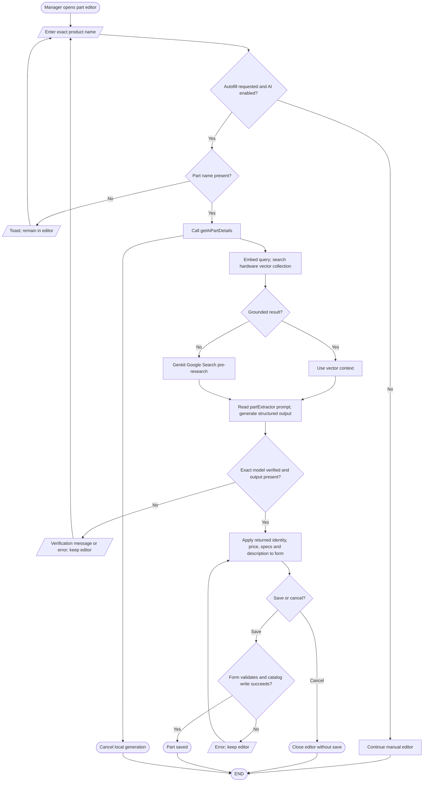

# AI part detail extraction and autofill

## Simple explanation

This flowchart shows how staff can fill a part form with AI help. Staff enter basic product details and ask the AI to find the missing fields. The system first looks for useful hardware guide data and may use web research when needed. The suggested name, price, description, and details are placed into editable fields. Staff must review the values before saving the part.

Sources: `src/components/add-part-editor.tsx`, `src/hooks/use-part-form.ts`, `src/app/actions.ts` (`getAiPartDetails`), `src/ai/flows/extract-part-details.ts`, `src/lib/vector-retriever.ts`. The extraction prompts explicitly use USD × 56 for estimated PHP pricing, whereas `src/lib/utils.ts` defines USD × 60. This mismatch is checked-in behavior; generated prices still require manager review. The flow uses optional vector grounding, then a research step when no vector context is found. Google Search availability is not runtime verified.
