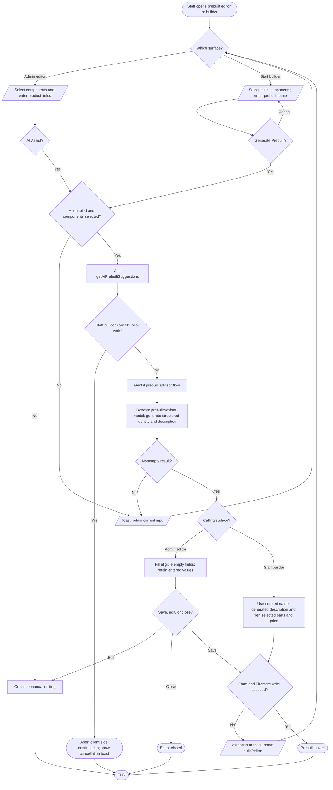

# AI prebuilt naming and description assistance

## Simple explanation

This flowchart shows how AI helps staff describe a ready-made PC. Staff first select the parts that belong to the system. The AI uses those parts to suggest a name, a short description, and a level. Empty fields can be filled with the suggestions without locking the form. Staff can change the text before the system is saved.

The admin prebuilt editor calls `getAiPrebuiltSuggestions` and only fills fields that were empty (`src/components/add-prebuilt-dialog.tsx`). The staff prebuilt builder invokes the same action via `src/hooks/use-build-actions.ts`, after a name modal in `src/components/build/build-action-footer.tsx`. The Genkit flow in `src/ai/flows/ai-prebuilt-advisor.ts` requires selected components. A second prebuilt form component, `src/components/prebuilt-builder-add-dialog.tsx`, has AI assist code but no page import was found.
