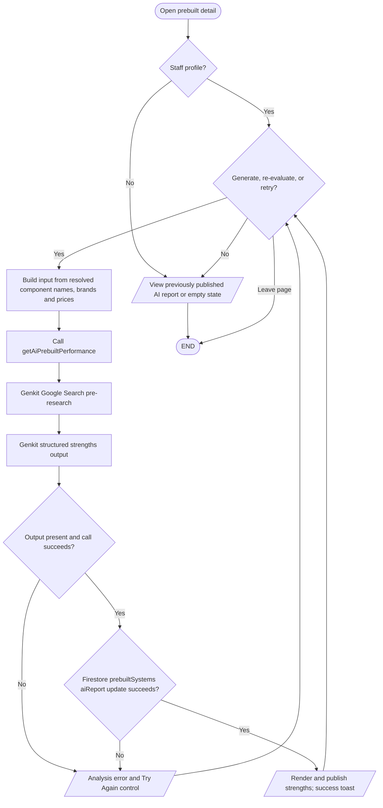

# AI prebuilt performance report

## Simple explanation

This flowchart shows how an AI report is made for a ready-made PC. The system collects the PC’s parts and checks that enough information is present. The AI reviews likely uses, strong points, weak points, and expected results. Staff can make the report again when the build changes. A finished report can be saved with the ready-made PC and shown on its product page.

Only staff sees the generate and re-evaluate controls (`src/app/pre-builts/[id]/hooks/use-prebuilt-details.ts`, `components/prebuilt-ai-review.tsx`). The report is stored on the prebuilt document after successful generation. The server wrapper and flow are `getAiPrebuiltPerformance` in `src/app/actions.ts` and `src/ai/flows/ai-prebuilt-performance.ts`. The prompt requests strengths only; it does not perform a balanced critique. Customer reservation and customization are separate [prebuilt workflows](../prebuilts-flowchart.md).
