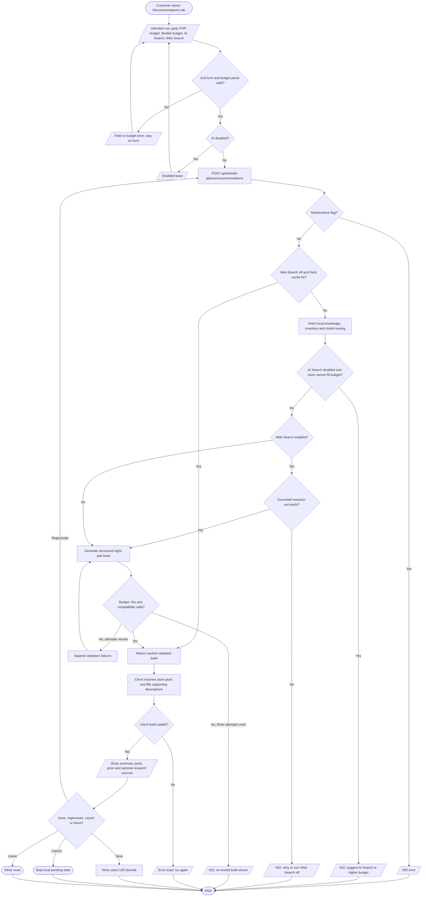

# AI Build Advisor recommendations

## Simple explanation

This flowchart shows how the Build Advisor suggests a new PC. The user chooses what the PC is for and enters a budget. The user may also allow a wider budget, AI search, or web search. The server asks the AI for a full set of parts and checks the answer before returning it. The user can review the total, retry the request, or save a good result.

The form persists draft fields in browser local storage. Non-web responses may be cached both by the server and client; Web Search requests bypass that reuse. The server result is complete before its stream wrapper sends JSON. Sources: `src/components/chat-form.tsx`, `src/app/ai-build-advisor/hooks/use-recommendation-logic.ts`, `src/app/api/ai/build-advisor/recommendations/route.ts`, `src/lib/validate-advisor-build.ts`, `src/components/build-summary.tsx`, `src/lib/advisor-web-research.ts`.
