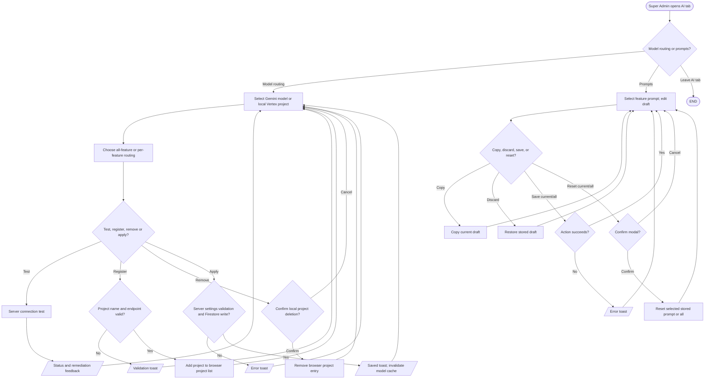

# Super Admin AI settings and prompts

## Simple explanation

This flowchart shows how the Super Admin controls AI settings. The Super Admin can choose which model is used for chat, Build Advisor, and prebuilt help. A test button checks whether a chosen model can answer. The prompt editor lets the Super Admin save new instructions or return to the default text. Saved settings change later AI requests, while unsaved choices do not.

The available routing keys are chatbot, build advisor and prebuilt advisor (`src/lib/ai-model-resolver.ts`). Settings UI is `src/components/ai-model-settings.tsx`; prompt UI is `src/components/ai-system-prompts-settings.tsx` and `src/hooks/use-system-prompts.ts`. Server actions in `src/app/actions.ts` test models, save settings, and update/reset prompts. The project selector's browser list and the selected server routing are distinct states; the UI must apply settings to change server behavior.
