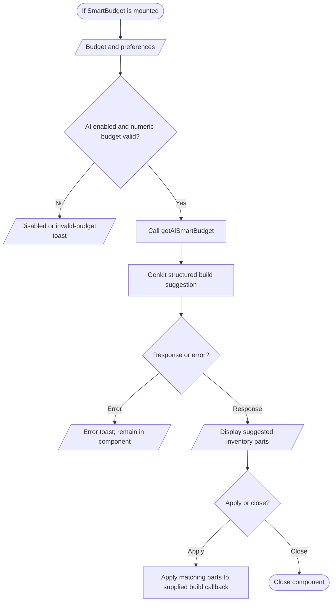

# Smart Budget source path (unmounted)

`src/components/smart-budget.tsx` and `src/ai/flows/ai-smart-budget.ts` implement this path, and `getAiSmartBudget` is exported from `src/app/actions.ts`. No import of `SmartBudget` by a page or mounted component was found, so this is a code-present workflow rather than a verified user navigation path.

No current route exposes this component. Its server action can be called by code, but the repository does not establish a user-facing Smart Budget screen.
