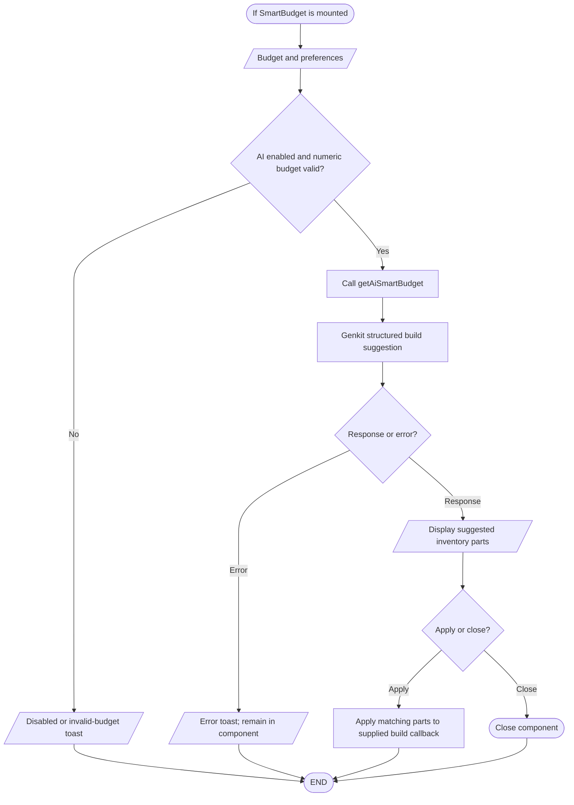

# Smart Budget source path (unmounted)

## Simple explanation

This flowchart describes Smart Budget code that exists in the project. No current page was found that opens this feature for a user. The code can take a budget and try to split it across PC parts. It may return a planned build or an error when it cannot finish. This should be treated as unused source code, not as a working page feature.

`src/components/smart-budget.tsx` and `src/ai/flows/ai-smart-budget.ts` implement this path, and `getAiSmartBudget` is exported from `src/app/actions.ts`. No import of `SmartBudget` by a page or mounted component was found, so this is a code-present workflow rather than a verified user navigation path.

No current route exposes this component. Its server action can be called by code, but the repository does not establish a user-facing Smart Budget screen.
