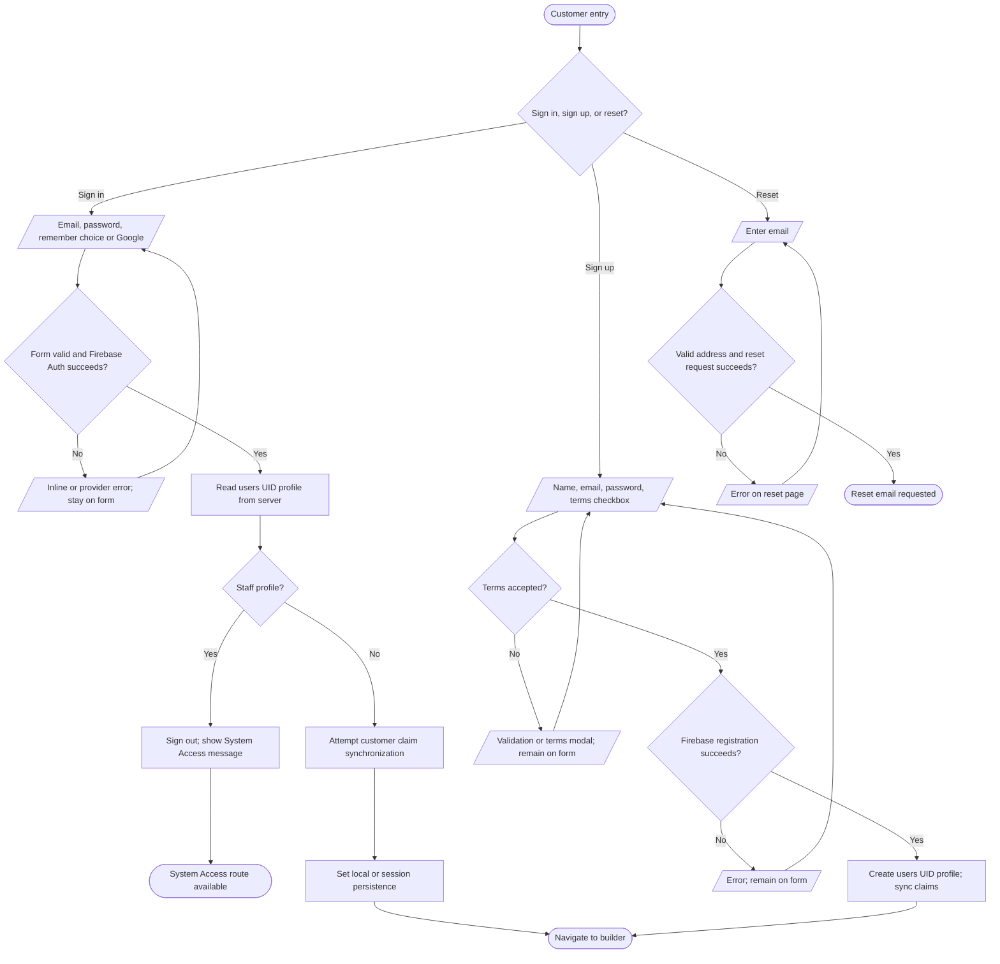
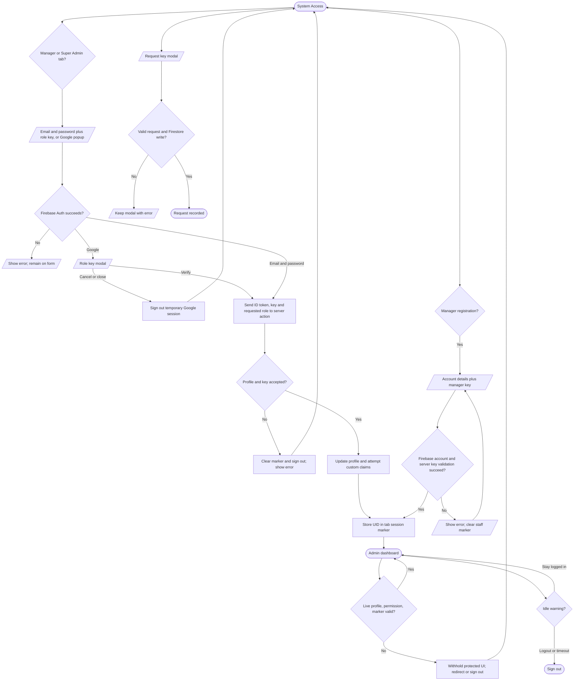

# Authentication and access flowcharts

## Customer identity

Google customer auth follows the same staff rejection and profile path. Popup cancellation and provider errors return to the form. Sources: `src/app/signin/page.tsx`, `src/app/signup/page.tsx`, `src/app/forgot-password/page.tsx`, `src/firebase/auth/google-auth.tsx`, `src/components/auth/terms-of-agreement-modal.tsx`.

## Staff access and guards

The live profile is read from `users/{uid}` and client roles are derived by `getEffectiveRole`; Firestore rules use custom claims for privileged writes. The guard is a client navigation guard, while server actions and Firestore rules have separate checks. Sources: `src/app/system-access/page.tsx`, `src/app/system-access/signup/page.tsx`, `src/app/actions.ts` (`authenticateSystemAccessAction`, `registerManagerAction`), `src/context/user-profile.tsx`, `src/lib/auth-utils.ts`, `src/components/auth/route-guard.tsx`, `src/hooks/use-admin-session-guard.ts`, `src/components/auth/session-timeout.tsx`, `firestore.rules`.
