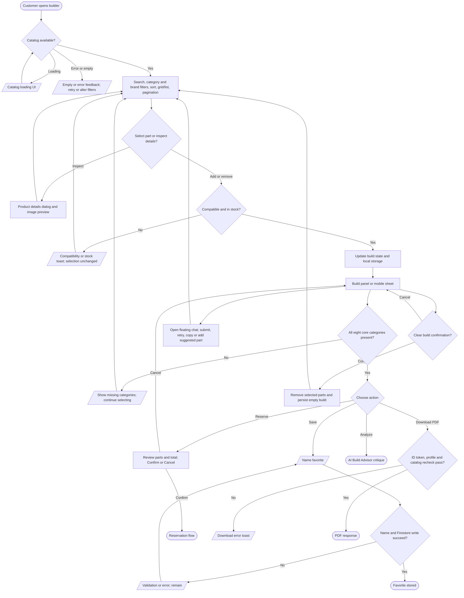

# Custom builder workflow

The `/builder` server page prefetches the catalog and mounts the client builder; inventory can also load through client Firestore hooks. Selection is kept in browser storage (`src/app/builder/page.tsx`, `builder-page.tsx`, `hooks/use-inventory-query.ts`, `hooks/use-builder-logic.ts`).

The compatibility filter and add/remove checks use `src/lib/compatibility.ts`; performance indicators use `src/lib/bottleneck.ts` and `src/lib/fps-estimator.ts`. Favorite loading or prebuilt customization passes part IDs to the builder and may warn about missing or unavailable catalog records (`src/components/your-build.tsx`, `src/app/builder/hooks/use-builder-logic.ts`). PDF generation verifies a Firebase ID token and reloads canonical items and image bytes (`src/app/api/builder/download/route.ts`). The floating chatbot is documented [separately](ai-system/ai-chatbot-flowchart.md).
