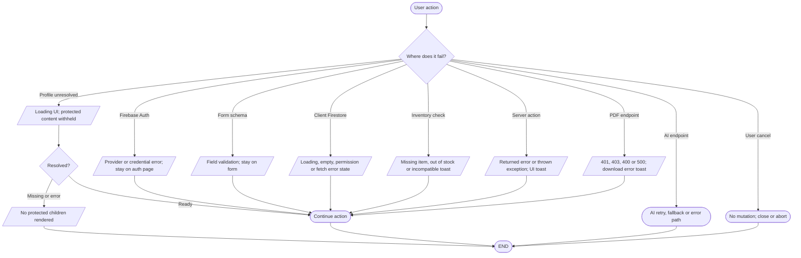

# Error and edge-case flows

## Simple explanation

This flowchart shows how the app handles common problems. It covers loading, missing data, bad form values, blocked access, and failed save actions. The app should keep the user on a safe page and explain what went wrong. Retry, sign-in, back, or cancel actions are shown when they can help. These paths stop a failed request from looking like a successful one.

| Case | Checked-in behavior and source |
| --- | --- |
| Unauthorized route | `RouteGuard` waits for live profile, then withholds children and redirects. Staff routes also require a UID marker (`src/components/auth/route-guard.tsx`, `src/hooks/use-admin-session-guard.ts`). |
| Unverified profile | Cached or pending Firestore snapshots are not treated as verified; a missing profile or snapshot timeout leaves protected content withheld (`src/context/user-profile.tsx`). |
| Authentication validation | Zod/form errors and Firebase errors remain on the sign-in, sign-up, staff access or reset page (`src/app/signin/page.tsx`, `signup/page.tsx`, `system-access/page.tsx`, `forgot-password/page.tsx`). |
| Catalog and build selection | Missing data, incompatible part and out-of-stock checks show feedback without adding the item (`src/app/builder/hooks/use-builder-logic.ts`). |
| Reservation transaction | Missing or unavailable item, permission/status failure, or transaction error returns an error to the invoking UI (`src/app/checkout-actions.ts`, `prebuilt-reservation-actions.ts`). |
| PDF | Token, role and input failures return HTTP errors; missing cover image or generation failure returns 500 (`src/app/api/builder/download/route.ts`). |
| AI | Feature-specific checks, model fallback and retry behavior are mapped in [AI error handling](ai-system/ai-error-handling-flowchart.md). |
| Contact form | A timer produces a local success state. The repository does not implement delivery or a network-failure branch (`src/app/contact/page.tsx`). |
| Browser cancellation | Dialog cancellation closes the overlay; AI request cancellation may stop client display without proving remote model termination (`src/app/ai-build-advisor/hooks/`, `src/hooks/use-build-actions.ts`). |

Static inspection cannot establish production network failures, deployed Firestore rule state, or actual provider response availability.
