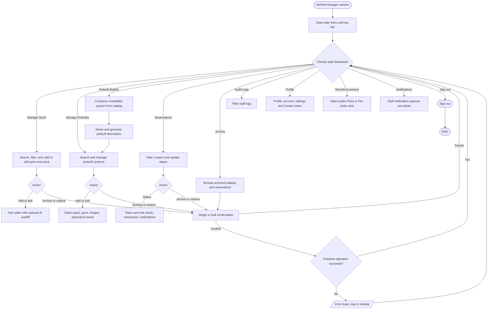

# Manager workflow

## Simple explanation

This flowchart shows what a Manager can do after staff sign-in. The side menu opens stock, prebuilts, the prebuilt builder, reservations, archives, and audit logs. Managers can add and edit records, change stock, update order status, and restore archived items. They can use AI help in part and prebuilt forms, but they cannot use the Super Admin sections. Delete buttons for parts, prebuilts, and reservations are also hidden from Managers.

Manager access requires Firebase Auth, a verified Firestore profile, and a tab session marker created by the System Access key flow. `src/app/admin/page.tsx` renders the manager tab set; `src/app/admin/prebuilt-builder/page.tsx` uses the same staff guard.

Delete controls for parts, prebuilts, and reservations are not rendered for Managers. See [admin inventory](admin-inventory-flowchart.md), [admin operations](admin-operations-flowchart.md), [AI prebuilt assist](ai-system/ai-prebuilt-assist-flowchart.md), and [pop-up decisions](popup-decision-flowcharts.md). Manager-only restrictions are implemented in the UI hooks as well as Firestore rules; the action-specific boundary depends on the invoked operation.
