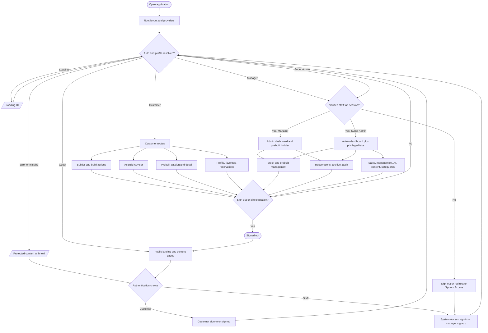

# Master system flowchart

This is the navigation map. The linked role and feature diagrams expand each module. The root layout mounts Firebase, profile, site settings, theme, loading, and shared shell providers (`src/app/layout.tsx`, `src/components/app-layout.tsx`).

Details: [authentication](authentication-flowchart.md), [user](user-flowchart.md), [manager](manager-flowchart.md), [Super Admin](super-admin-flowchart.md), [AI system](ai-system/ai-master-flowchart.md). The header provides desktop and mobile navigation, profile menu, notification entry points, theme toggle, and sign-out confirmation (`src/components/header.tsx`). The landing page redirects an already verified user to `/builder` or staff to `/admin` (`src/components/landing/landing-page.tsx`).
