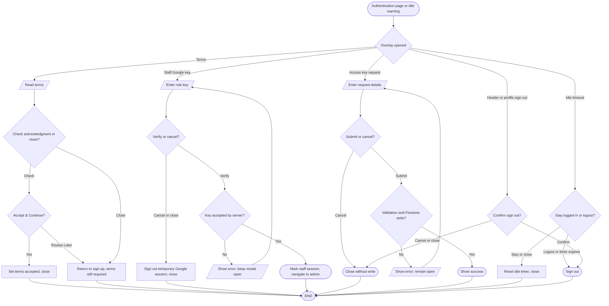
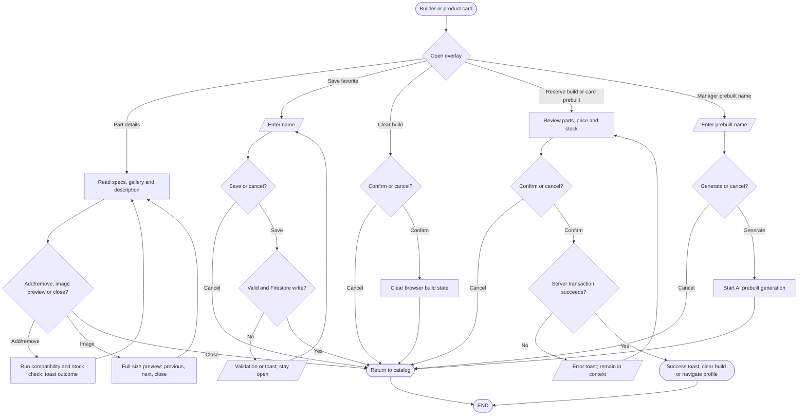
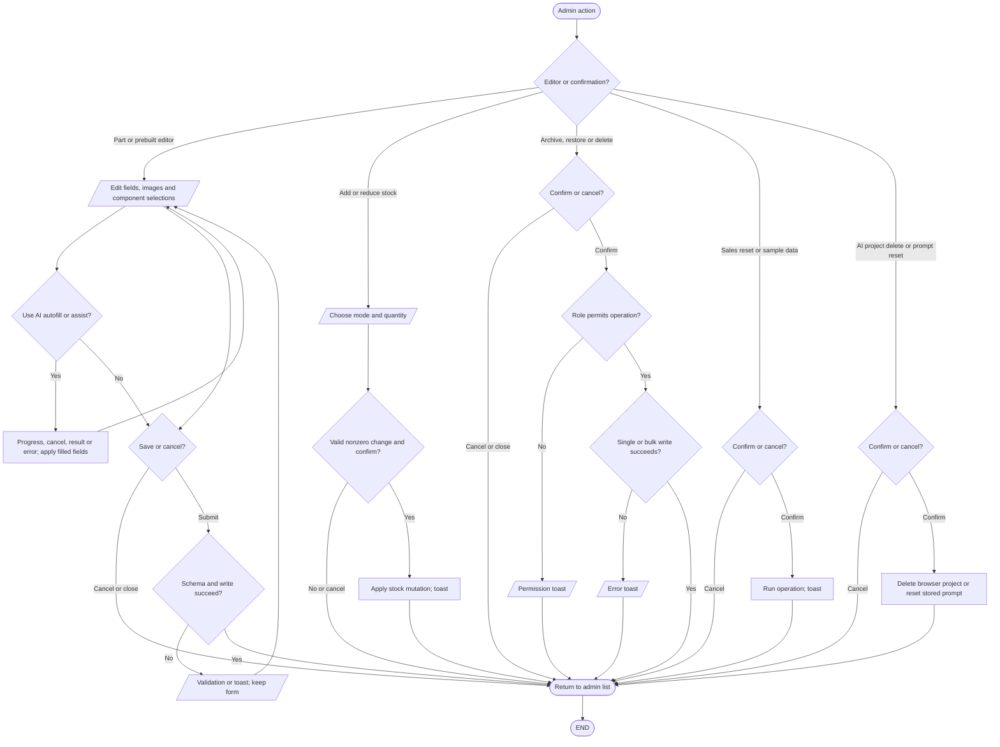
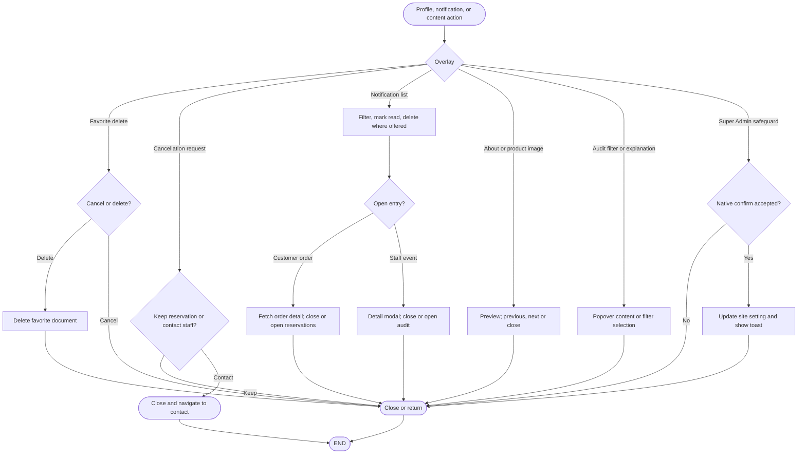

# Pop-up and decision flows

The [inventory](interaction-inventory.md#overlay-inventory) lists each source instance. These diagrams group overlays that share the same decision pattern; the table following them records their distinct choices. Closing an overlay through its close control, Escape key, or backdrop follows its `onClose` or `onOpenChange` handler where configured. Native component behavior beyond those handlers was not runtime tested.

## Authentication and session overlays

### Simple explanation

This flowchart covers popups used during sign-in, sign-up, and session checks. A user may need to accept the terms, enter a staff key, or confirm sign-out. The idle warning lets a signed-in person stay signed in or leave now. Closing a popup keeps the current page when no action was confirmed. Errors stay visible so the user knows what must be fixed.

Sources: `src/components/auth/terms-of-agreement-modal.tsx`, `session-timeout.tsx`, `src/app/system-access/page.tsx`, `signup/page.tsx`, `components/request-key-modal.tsx`, `src/components/header.tsx`, `src/app/profile/components/profile-hero.tsx`, `profile-sidebar.tsx`.

## Build, catalog and product overlays

### Simple explanation

This flowchart covers popups used while browsing products or making a build. Users can view product details, save a build, clear parts, or confirm a reservation. Mobile users can open the build list in a drawer. Product images may open in a larger view. A confirmed action continues the task, while Cancel closes the popup without making the change.

The prebuilt detail page's Reserve action is direct and has no confirmation overlay; the listing and landing card use one (`src/app/pre-builts/[id]/components/prebuilt-action-card.tsx`, `src/components/prebuilt-system-card.tsx`). The builder's manager name and customer reservation modals share `src/components/build/build-action-footer.tsx`.

## Admin mutation overlays

### Simple explanation

This flowchart covers staff popups that can change saved store data. Staff can add or edit parts and prebuilts, change stock, or work with selected records. Archive, restore, reset, and delete actions show a warning before they run. The popup names the action so staff can check it before pressing Confirm. Closing or cancelling the popup leaves the saved data unchanged.

Admin confirmation sources: `src/app/admin/page.tsx`, `src/app/admin/components/admin-tab-header.tsx`, `reservations-tab.tsx`, `src/components/inventory-part-card.tsx`, `inventory-table.tsx`, `inventory-prebuilt-card.tsx`, `prebuilts-table.tsx`, `ai-model-settings.tsx`, `ai-system-prompts-settings.tsx`.

## Profile, notifications and secondary overlays

### Simple explanation

This flowchart covers popups opened from Profile, alerts, and other small tools. Customers can view order details, remove a saved build, or choose what to do with a reservation. Staff can open alert details and move to the related audit page. Image previews and detail boxes can be closed without changing data. Any action that removes saved data asks for confirmation first.

### Choice and outcome notes

| Overlay family | Additional implemented choices and outcomes |
| --- | --- |
| Header/mobile drawers and menus | Navigate to role-appropriate links; close drawer on navigation; profile menu opens profile sections, settings or sign-out modal (`header.tsx`, `header-mega-menu.tsx`). |
| Builder mobile sheet and action menu | Open/close build review; Save, PDF, Clear, or load a favorite. Save/Clear open nested modals (`your-build.tsx`). |
| Part and prebuilt selection popovers | Search/select a part, clear query, remove a slot, or close; changes remain in the parent editor (`add-prebuilt-dialog.tsx`, `prebuilt-builder/part-selector.tsx`). |
| Filter/sort menus | Toggle categories/brands/tiers, select availability or sort, reset filters where offered; update local list state without a write (`inventory-toolbar.tsx`, admin stock/prebuilt tabs). |
| AI explanation and telemetry popovers | Expand rationale or diagnostic detail, then close; no persistence (`component-card.tsx`, chat telemetry, audit log components). |
| Prebuilt image and part previews | Select image, previous/next image, or close; no write (`prebuilt-image-view.tsx`, `part-details-content.tsx`). |
| Reservation administration | Archive, restore, or permanent delete uses a shared pending-action modal; Cancel clears it, Confirm invokes the matching operation (`reservations-tab.tsx`). |
| Sales confirmations | Confirm sample-data ingest or reset; Cancel closes with no operation (`admin-tab-header.tsx`). |
| AI prompts | Reset current prompt or all prompts after confirmation; Cancel closes (`ai-system-prompts-settings.tsx`). |
| AI model project removal | Cancel retains browser project list; Delete removes selected local project from that list (`ai-model-settings.tsx`). |
| Notification popovers | Customer: mark one/all read, delete, inspect order, open reservations. Staff: mark one/all read, inspect event, open audit (`user-notifications.tsx`, `notification-center.tsx`). |

Feedback toasts acknowledge success, validation, permission denial or errors; the advisor ready toast also has an action to view a finished result (`src/components/advisor-job-toast.tsx`). The AI progress modal's Cancel and completion actions are covered in [AI decisions](ai-system/ai-decision-flowchart.md).
