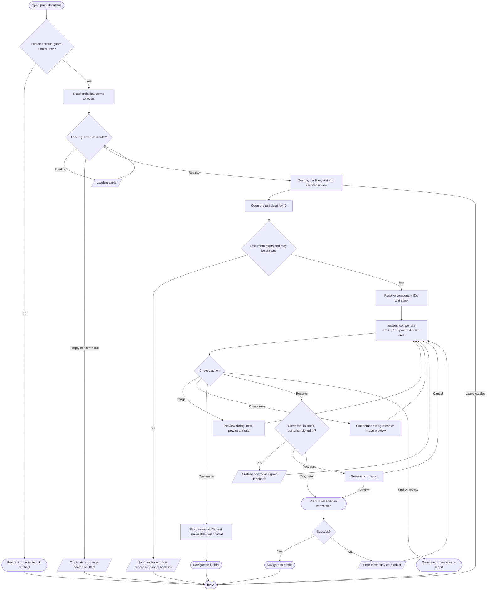

# Prebuilt catalog and detail workflow

## Simple explanation

This flowchart shows how users browse ready-made PCs. The list can be searched, filtered, sorted, and changed between card and table views. Opening a PC shows its images, parts, price, stock, and AI report. A customer can move its parts into the Builder or reserve it when all needed items are available. Staff can open the same product for review and return to inventory management.

The listing and landing card use a confirmation dialog (`src/components/prebuilt-system-card.tsx`); the detail page's action card calls `handleReserve` directly without that dialog (`src/app/pre-builts/[id]/components/prebuilt-action-card.tsx`, `hooks/use-prebuilt-details.ts`). Archived detail visibility and report generation depend on the staff profile. Prebuilt creation is in [admin inventory](admin-inventory-flowchart.md); report generation is in [AI prebuilt analysis](ai-system/ai-prebuilt-performance-flowchart.md).
