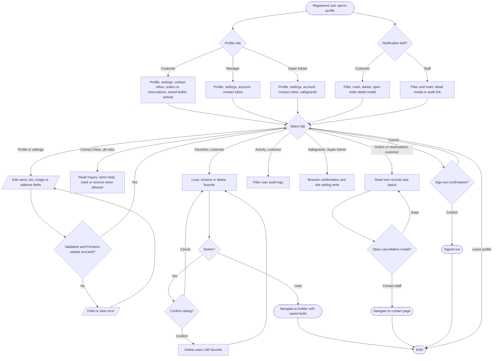

# Profile, favorites and notifications

## Simple explanation

This flowchart shows what a signed-in person can do from the Profile page. Every role can edit basic account details and use the Contact Inbox. Customers can also view orders or reservations, saved builds, activity, and alerts. Super Admins get extra safety switches for store and AI features. The page hides tabs that do not belong to the signed-in role.

Sources: `src/app/profile/page.tsx`, `src/app/profile/hooks/`, `src/app/profile/components/`, `src/components/user-notifications.tsx`, `src/components/notification-center.tsx`, `src/components/order-details-modal.tsx`. A customer-only direct URL tab is sanitized for staff; legacy admin tab names redirect to `/admin`.
