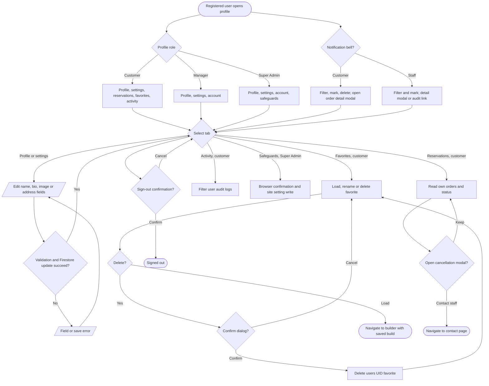

# Profile, favorites and notifications

Sources: `src/app/profile/page.tsx`, `src/app/profile/hooks/`, `src/app/profile/components/`, `src/components/user-notifications.tsx`, `src/components/notification-center.tsx`, `src/components/order-details-modal.tsx`. A customer-only direct URL tab is sanitized for staff; legacy admin tab names redirect to `/admin`.
