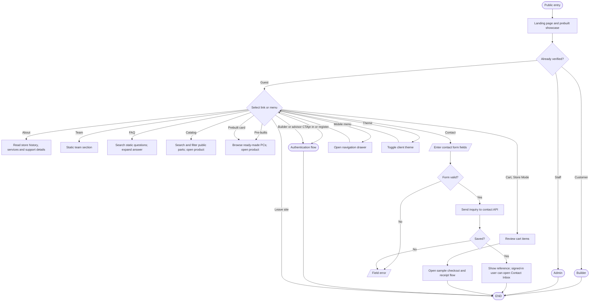

# Public pages and navigation

## Simple explanation

This flowchart shows how a guest moves through the public side of the app. The header links to Home, Parts, Pre-builts, About, Team, FAQ, and Contact where the page allows it. Guests can browse products and open full product details without using the staff dashboard. The Contact form sends an inquiry, while signed-in users can later follow replies in Profile. Sign-in links move customers or staff into the correct account flow.

The shared header renders role-dependent desktop links, a mobile drawer, a profile menu, notifications for signed-in users, a theme toggle, and sign-out confirmation (`src/components/header.tsx`, `src/components/app-layout.tsx`). Informational copy is not evidence of fulfillment or support integrations.

`src/app/contact/page.tsx` sends the form to `/api/contact`; signed-in users can follow replies in the Contact Inbox, while guests cannot follow replies inside the app. The checkout route is clearly marked as a UI simulation and does not make a real payment (`src/app/checkout/page.tsx`). Existing routing and direct-link restrictions are expanded in [authentication](authentication-flowchart.md) and [prebuilts](prebuilts-flowchart.md).
