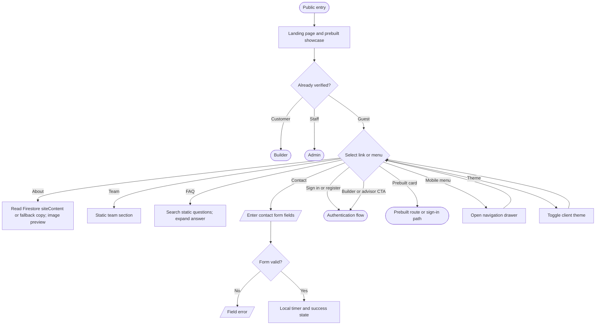

# Public pages and navigation

The shared header renders role-dependent desktop links, a mobile drawer, a profile menu, notifications for signed-in users, a theme toggle, and sign-out confirmation (`src/components/header.tsx`, `src/components/app-layout.tsx`). Informational copy is not evidence of fulfillment or support integrations.

`src/app/contact/page.tsx` does not send the contact form to a backend. The About image opens a preview modal and closes without a database mutation (`src/app/about/page.tsx`). Existing routing and direct-link restrictions are expanded in [authentication](authentication-flowchart.md) and [prebuilts](prebuilts-flowchart.md).
