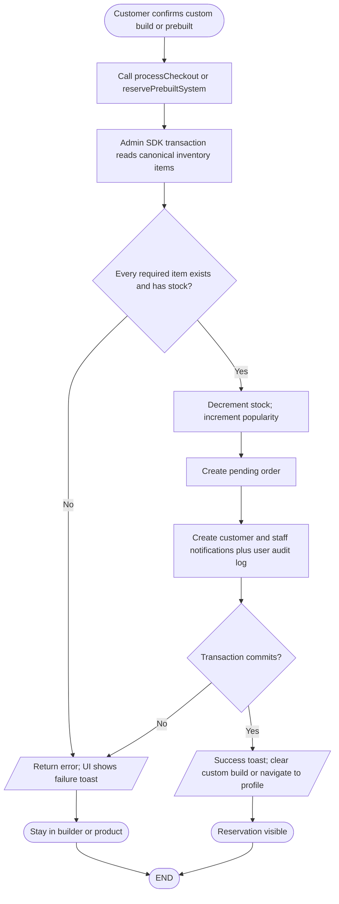
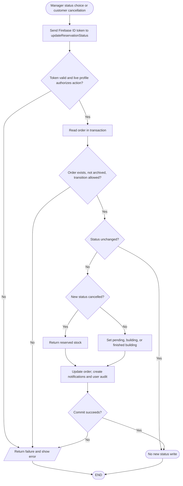

# Reservation and fulfillment workflows

## Creation

### Simple explanation

This flowchart shows how a new reservation starts. A customer chooses a complete custom build, a ready-made PC, or one available part. The app checks the signed-in user, stock, and needed product details. A valid request creates an order and updates stock in one protected action. The customer and staff can then see the new reservation and its first status.

`processCheckout` and `reservePrebuiltSystem` receive customer identifiers and item data as action arguments. They recheck item existence and stock, but neither creation action independently verifies a Firebase ID token. This is a source observation, not a runtime exploit finding (`src/app/checkout-actions.ts`, `src/app/prebuilt-reservation-actions.ts`).

## Status and cancellation

### Simple explanation

This flowchart shows what happens after a reservation is created. Staff can move the order through its allowed status steps. The customer can view the latest status from Profile and related alerts. The current customer Cancel button opens a choice to keep the order or contact staff. Staff can archive or restore records, while permanent delete is limited to the Super Admin.

The current customer profile UI's Cancel button opens a modal offering Keep Reservation or Contact Staff, then navigates to `/contact` with a subject; it does not invoke the hook's `handleCancelReservation` (`src/app/profile/page.tsx`, `src/app/profile/components/reservations-list.tsx`, `src/app/profile/hooks/use-reservations.ts`). Staff status changes call the token-verified action through `src/app/admin/hooks/use-orders.ts`. Archive, restore and permanent delete are separate Firestore operations and confirmation choices in `src/app/admin/components/reservations-tab.tsx`.
