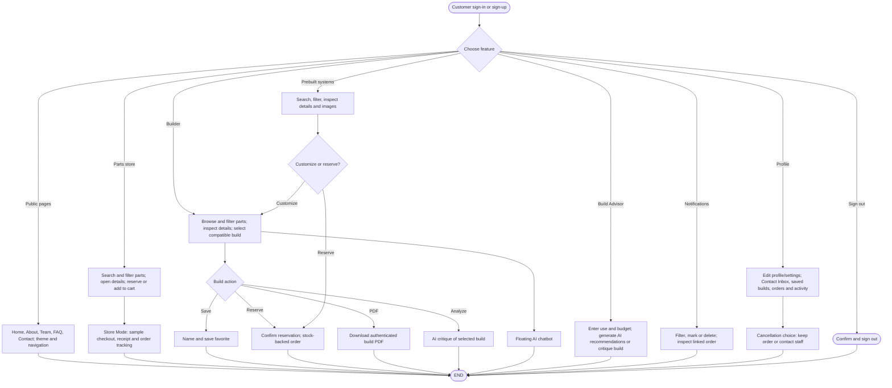
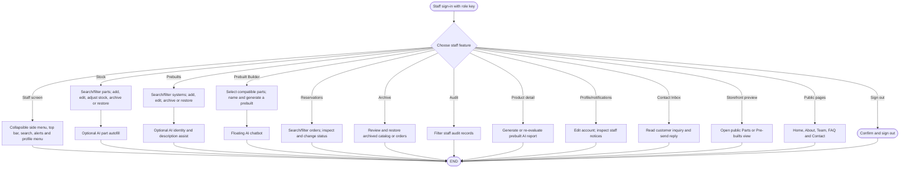
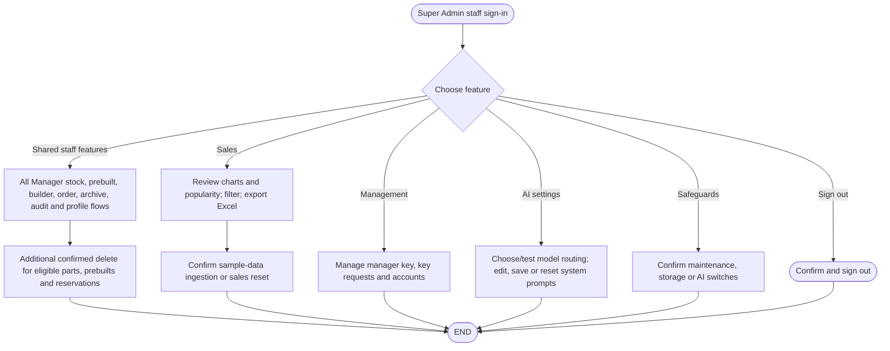
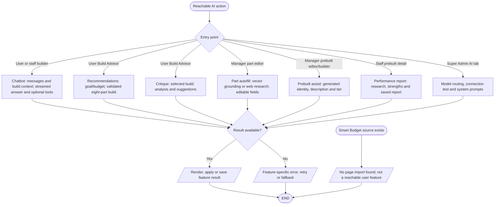

# Simplified all-features map

This one-page map summarizes the implemented, reachable features by role and keeps AI processing separate. It is a navigation aid, not a replacement for the [detailed flowcharts](README.md) or [source interaction inventory](interaction-inventory.md). The diagrams show principal choices and destinations; the linked detail pages cover checks, dialogs, writes, and error cases. Source inspection was updated on 27 October 2026; live Firebase data and deployed AI services were not exercised.

## User (non-admin)

### Simple explanation

This flow shows the features available to a normal customer. The customer can browse Parts and Pre-builts, make a custom build, or ask the Build Advisor for help. The customer can save builds, reserve products, send inquiries, and read staff replies in Profile. When Store Mode is on, the customer can also use the cart, sample checkout, and sample order tracking. Alerts and the account menu help the customer follow activity and sign out safely.

Customer access and navigation: `src/app/signin/page.tsx`, `src/app/signup/page.tsx`, `src/components/header.tsx`, `src/app/parts/`, `src/app/checkout/`, `src/app/builder/`, `src/app/ai-build-advisor/`, `src/app/pre-builts/`, and `src/app/profile/`. See [User](user-flowchart.md), [builder](builder-flowchart.md), [prebuilts](prebuilts-flowchart.md), [reservations](reservations-flowchart.md), and [profile](profile-flowchart.md). The Contact form sends an inquiry through `/api/contact`. The visible cancellation modal routes to Contact Staff; it does not directly cancel the order.

## Manager

### Simple explanation

This flow shows the work available to a Manager. The Manager uses the new side menu to open stock, prebuilts, the prebuilt builder, reservations, archives, and audit logs. Parts and prebuilts can be added, edited, restocked, archived, or restored. AI tools can help fill part details, name ready-made PCs, and review a PC’s expected results. Manager accounts cannot open Super Admin sections or use permanent delete controls.

Manager modules are rendered by `src/app/admin/page.tsx`, `src/app/admin/prebuilt-builder/page.tsx`, `src/app/profile/page.tsx`, and `src/app/pre-builts/[id]/page.tsx`. The manager's delete controls are not rendered. See [Manager](manager-flowchart.md), [admin inventory](admin-inventory-flowchart.md), and [admin operations](admin-operations-flowchart.md).

## Super Admin

### Simple explanation

This flow shows the extra work available to a Super Admin. The Super Admin can do everything a Manager can do. Extra sections show sales reports, staff accounts, role keys, AI models, and AI prompts. The Super Admin can also use safety switches in Profile and confirm permanent delete actions. Storefront preview links open the public Parts and Pre-builts pages from the staff side menu.

The additional tabs and controls depend on the Super Admin profile in `src/app/admin/page.tsx` and `src/app/profile/page.tsx`; the guarded actions are in `src/app/actions.ts` and related hooks. See [Super Admin](super-admin-flowchart.md), [admin operations](admin-operations-flowchart.md), and [AI settings](ai-system/ai-settings-flowchart.md).

## AI flows (separate from role navigation)

### Simple explanation

This flow shows every AI tool apart from the user roles. AI can answer Builder questions, suggest a full PC, review a chosen build, fill part details, and help describe a ready-made PC. Each tool sends its own input and may use product data, guide data, or web search. The app checks the result before it is shown, used, or saved. If the request fails, the page shows an error, retry choice, or safe fallback.

The [AI master](ai-system/ai-master-flowchart.md) and [AI interaction inventory](ai-system/ai-interaction-inventory.md) trace these paths to `src/app/api/chat/route.ts`, `src/app/api/ai/build-advisor/recommendations/route.ts`, `src/app/actions.ts`, and `src/ai/flows/`. AI availability and remote cancellation remain unverified at runtime. Smart Budget is shown only to distinguish code-present functionality from a mounted feature.
