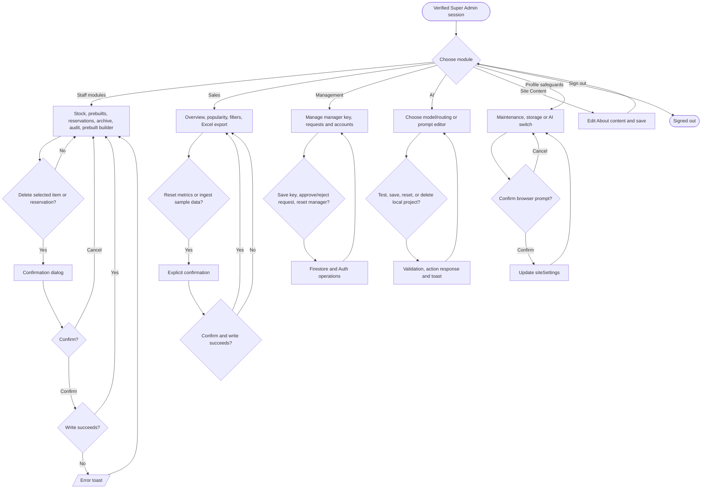

# Super Admin workflow

Super Admin inherits manager modules and receives additional tabs and profile safeguards when `profile.isSuperAdmin` is true (`src/app/admin/page.tsx`, `src/app/profile/page.tsx`).

See [admin operations](admin-operations-flowchart.md), [AI settings](ai-system/ai-settings-flowchart.md), [pop-up decisions](popup-decision-flowcharts.md). The local fine-tuned project list is stored in browser state; saving AI settings writes selected routing and model configuration through a server action (`src/components/ai-model-settings.tsx`, `src/app/actions.ts`).
